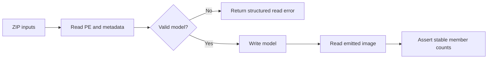

# fix-fuzz-roundtrip - Plan

## Scope & Non-Goals

- **Goal:** Fix the supplied roundtrip fuzz failure with permanent regression coverage.
- **In scope:** Reader/writer invariants responsible for the supplied crash and corpus failures.
- **Non-goals:** Unrelated refactors, API redesigns, or weakening the fuzz invariant.

## Acceptance Criteria

- [x] Explain and fix crash aabf8069a17c15070ccb08760d07820dbb46ba38.
- [x] Add small deterministic tests that fail before the fix and pass afterward.
- [x] Replay all 1,204 supplied inputs with the roundtrip fuzz invariant and no failures.
- [x] Run relevant fixture/regression checks and formatting validation.

## Assumptions & Constraints

- Preserve the public API; reject malformed metadata with a structured error where appropriate.
- Windows host has stable and nightly Rust; use local replay if sanitizer fuzzing is unavailable.
- Preserve existing untracked ZIP files, .claude/, and other user-owned files.
- Local reproduction and regression checks are authorized by the requested fuzz repair.
- All tasks are sequential and owned by the main agent; no prior delegated work exists.

## Baseline Tests

| Item | Command | Baseline result (at start) |
| --- | --- | --- |
| Commit / ref | git rev-parse HEAD | c38da47539397079f21d51877b30e8604daf1d67, main, no tracked changes |
| Crash reproduction | cargo run -p cecli-cli -- roundtrip tmp/fuzz-roundtrip-20260912/artifacts/roundtrip/crash-aabf8069a17c15070ccb08760d07820dbb46ba38 | Fails: counts (298, 2783, 1745, 803, 1) become (298, 2783, 1745, 766, 1) |
| Fixture baseline | cargo test -p cecli --test fixtures_roundtrip | 7 passed, 0 failed |
| Reader baseline | cargo test -p cecli --lib read::module_reader::tests | 9 passed, 0 failed |
| Full archive baseline | target/debug/roundtrip-replay.exe tmp/fuzz-roundtrip-20260912/artifacts tmp/fuzz-roundtrip-20260912/corpus | 1,204 inputs: 451 successful roundtrips, 752 read rejections, 1 failure (reported crash) |

## Diagram

## Task Checklist

| ID | Task | Owner | Deps | Done |
| --- | --- | --- | --- | --- |
| T1 | Reconcile existing plan, extract inputs, reproduce reported crash | [main] | - | [x] |
| T2 | Trace root cause and establish focused baseline | [main] | T1 | [x] |
| T3 | Add deterministic failing regression coverage | [main] | T2 | [x] |
| T4 | Fix the reader/writer invariant and run focused tests | [main] | T3 | [x] |
| T5 | Replay supplied corpus, run relevant checks, review diff | [main] | T4 | [x] |
| T6 | Record verification evidence and close plan | [main] | T5 | [x] |

## Sub-agent Registry

No delegation. The prior registry contained only template placeholders; live agent inspection found only the main agent.

| Task ID | Agent Ref | Status | Integration | Owned Files | Checkpoint / Next Action | Updated |
| --- | --- | --- | --- | --- | --- | --- |

## Risks & Rollback

| Risk | Likelihood / Impact | Mitigation | Rollback |
| --- | --- | --- | --- |
| Rejecting legal metadata while tightening validation | Medium / medium | Cover legal edge cases and run fixture roundtrips | Revert only this task's source edits |
| Related corpus failures | Medium / medium | Replay the complete supplied archive | Keep additional fixes narrowly scoped |

## Blockers

None.

## Change Log

| Time (YYYY-MM-DD HH:mm) | Task ID | File / Task | Change | By |
| --- | --- | --- | --- | --- |
| 2026-09-12 22:32 | T1 | Plan and ZIP triage | Replaced unfinished template with reconciled plan; extracted 1 crash and 1,203 corpus entries into ignored tmp/fuzz-roundtrip-20260912/; reproduced loss of 37 properties | main |
| 2026-09-12 22:44 | T2 | Root cause and local replay tool | Physical Property table has 766 rows; PropertyMap row 14 has parent RID 15616 and regresses list start from 60 to 25, while row 24 also regresses. Reader follows unchecked runs, pushes duplicate definitions and leaves invalid handles/unowned properties. EventMap has the same logic. Added ignored local replay/inspection tool and completed baseline replay | main |
| 2026-09-12 22:46 | T3 | crates/cecli/tests/member_maps.rs | Added synthetic image regressions for invalid map parents, list bounds/order/coverage, duplicate parents, valid empty ranges, and reordered parents; pre-fix run pending | main |
| 2026-09-12 22:46 | T3 | Pre-fix regressions | cargo test -p cecli --test member_maps: 3 rejection tests failed, 2 valid-input tests passed | main |
| 2026-09-18 22:49 | T4 | crates/cecli/src/read/module_reader.rs | Resumed and reconciled workspace. Added shared PropertyMap/EventMap validation for valid unique parents and full monotonic bounded member ranges; arena population now uses validated ranges and owners | main |
| 2026-09-18 22:52 | T4 | Focused validation | 5 new regression tests and 7 fixture tests passed; original crash returns BadImage (PropertyMap parent out of range). Formatting, Clippy, and 272 library tests passed | main |
| 2026-09-18 22:52 | T5 | Full archive replay | 1,204 inputs: 449 accepted roundtrips, 755 read rejections, 0 failures; investigating the two formerly accepted additional read rejections | main |
| 2026-09-18 22:55 | T5 | Rejection triage and final review | Compared all 18 map-related rejected inputs against the retained pre-fix CLI binary. Exactly two were previously accepted: 384b2ac64df489b56913eea70fe8814e17855862 has invalid EventMap parents 274/320 and start 287 for two event rows; 89ae4ec9278c989eed25921bb86cf1cb43f2065b has a PropertyMap start decreasing from 122 to 120. Both are malformed. Final source diff is limited to the shared map validator and validated arena population; added regression file is self-contained | main |
| 2026-09-18 22:55 | T6 | Plan | Recorded completed acceptance checks, root cause, compatibility impact, and deterministic replay limitation | main |

## Verification Evidence

| Time | Command | Result | Notes (regression vs. pre-existing) |
| --- | --- | --- | --- |
| 2026-09-12 22:30 | cargo run -p cecli-cli -- roundtrip tmp/fuzz-roundtrip-20260912/artifacts/roundtrip/crash-aabf8069a17c15070ccb08760d07820dbb46ba38 | Member-count mismatch | Confirmed supplied pre-fix crash |
| 2026-09-12 22:46 | cargo test -p cecli --test member_maps | 3 failed, 2 passed before fix | Confirms regression coverage catches invalid maps |
| 2026-09-18 22:50 | cargo test -p cecli --test member_maps --test fixtures_roundtrip | 12 passed | Includes 5 synthetic regressions and 7 existing fixture checks |
| 2026-09-18 22:51 | cargo test -p cecli --lib | 272 passed | No library regressions |
| 2026-09-18 22:51 | cargo fmt --all --check | Passed | Repository formatting clean |
| 2026-09-18 22:51 | cargo clippy -p cecli --all-targets -- -D warnings | Passed | No warnings |
| 2026-09-18 22:51 | cargo run --offline --manifest-path tmp/fuzz-roundtrip-20260912/tool/Cargo.toml --target-dir target -- tmp/fuzz-roundtrip-20260912/artifacts tmp/fuzz-roundtrip-20260912/corpus | 1,204 inputs, 449 roundtrips, 755 rejected reads, 0 failures | Same read/write/read/count invariant as fuzz target; deterministic replay without sanitizer instrumentation |
| 2026-09-18 22:51 | git diff --check | Passed | No whitespace errors |
| 2026-09-18 22:55 | target/debug/roundtrip-replay.exe --map-rejections tmp/fuzz-roundtrip-20260912/artifacts tmp/fuzz-roundtrip-20260912/corpus; compare each reported path with retained pre-fix target/debug/cecli.exe roundtrip | All map rejection causes inspected; two additional rejected inputs confirmed malformed | Full raw map inspection saved at tmp/fuzz-roundtrip-20260912/map-rejections.log |

## Bug & Fix Log

| Time | Symptom | Root cause | Fix (files) | Guard added (test/assert/check) |
| --- | --- | --- | --- | --- |
| 2026-09-18 22:55 | Fuzz roundtrip changes property count from 803 to 766 | Unchecked PropertyMap runs duplicate physical rows, accept invalid owners, and break rid-to-arena indexing; EventMap shares the flaw | read/module_reader.rs validates owners, uniqueness, list bounds/order, and full member coverage before populating arenas | tests/member_maps.rs: 5 tests cover both maps, malformed cases, legal empty ranges/tables, reordered parents, and ownership across two write/read cycles |

## Completion Summary

Fixed PropertyMap/EventMap validation without weakening the fuzz target or changing the public API. Malformed maps now return BadImage instead of producing duplicated, missing, or incorrectly indexed members. Valid empty ranges and differing parent order remain supported.

Verification is complete for this repair: all 1,204 supplied inputs replayed with 449 successful read/write/read cycles and 755 structured read rejections, with no panics or invariant failures. All 284 relevant tests passed (272 library, 7 fixture, 5 new regressions), and formatting, Clippy, and diff whitespace checks passed. The two additional read rejections were confirmed malformed by raw map inspection and comparison with the pre-fix CLI.

Validation used deterministic replay of the exact fuzz invariant on Windows, without sanitizer instrumentation or a new mutation campaign. No deployment or commit was requested. User-owned archive and unrelated files were preserved; extraction, replay helper, and diagnostic logs remain under ignored tmp/.

## Next Steps

None; repair and verification are complete.

