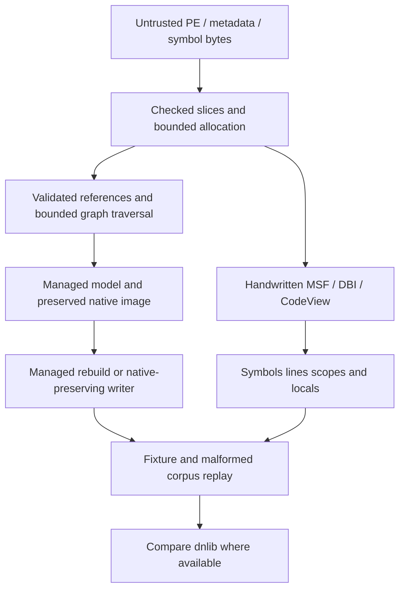

# Harden parsers and complete mixed mode and native PDB - Plan

## Scope & Non-Goals

Complete the user's requested parser hardening, mixed-mode PE/CLI reading and safe writing, and handwritten native PDB decoding without WinAPI. Preserve all pre-existing dirty changes, benchmark work, archives and unrelated plans. No commit or push is requested. dnlib parity is an empirical compatibility target; do not claim universal equivalence without evidence.

## Acceptance Criteria

- [x] Malformed lengths, indices, recursion and cross-references return structured errors without panics or unbounded allocations on the regression corpus.
- [x] Managed/native methods, native entry points and native PE data survive supported mixed-mode read/write operations, with explicit errors for unsupported edits.
- [x] Native PDB MSF/DBI/CodeView decoding is handwritten and platform independent, with useful symbols, lines and local information tested on real fixtures.
- [x] Existing fixture behavior and relevant all-feature tests, formatting and lints pass.
- [x] Document supported behavior, limitations and exact differential/replay evidence.

## Assumptions & Constraints

The old metadata-hardening plan was an unimplemented template with no delegated work. It matches the hardening part of this request and is resumed/expanded here. Other open plans cover unrelated performance work. No AGENTS.md was found in the repository/ancestors during initial inventory. Local regression tests and deterministic corpus comparisons are authorized by this implementation task. Public APIs remain compatible where practical; additive APIs are permitted. No OS debug APIs or new native PDB library dependency.

## Baseline Tests

| Item | Command | Baseline result (at start) |
| --- | --- | --- |
| Repository | git status --short; git log -1 --oneline | d508c8c with extensive pre-existing tracked/untracked edits; retained |
| Local suite | cargo test --workspace --all-features --quiet | Resumed baseline run; session 47079 |
| Existing PDB support | Inspect cecli-pdb/src/native | MSF7 and managed lines exist; rich debug symbols omitted |

## Diagram

## Task Checklist

| ID | Task | Owner | Deps | Done |
| --- | --- | --- | --- | --- |
| T1 | Reconcile plans, dirty baseline and parser contracts | [main] | - | [x] |
| T2 | Harden binary and metadata codecs with focused regressions | [main] | T1 | [x] |
| T3 | Complete native PDB parser with additive APIs and regression tests | [main] | T1 | [x] |
| T4 | Complete native-preserving mixed-mode read/write support | [main] | T1 | [x] |
| T5 | Harden high-level reference/signature/body resolution | [main] | T1 | [x] |
| T6 | Integrate symbol attachment and run differential/corpus checks | [main] | T2,T3,T4,T5 | [x] |
| T7 | Document capabilities, run acceptance checks and review all changes | [main] | T6 | [x] |

## Sub-agent Registry

| Task ID | Agent Ref | Status | Integration | Owned Files | Checkpoint / Next Action | Updated |
| --- | --- | --- | --- | --- | --- | --- |
| T2 | parser_hardening | superseded | rejected | cecli-core, cecli-metadata, cecli-cil, cecli-mdb; cecli-pdb portable/embedded only | Previous attempt unavailable in live agent inventory; replacement owns remaining work | 2026-10-23 |
| T3 | native_pdb | superseded | rejected | crates/cecli-pdb/src/native/** only | Previous attempt unavailable; native parser has no tracked diff | 2026-10-23 |
| T4 | mixed_mode | superseded | rejected | crates/cecli-pe/**; crates/cecli/src/assembly.rs, module_def.rs; new mixed-mode implementation and dedicated tests | Previous attempt unavailable; preserve existing PE/facade performance edits | 2026-10-23 |
| T2 | parser_hardening_resume | superseded | rejected | cecli-core, cecli-metadata, cecli-cil, cecli-mdb; cecli-pdb portable/embedded only | Implementation now on disk; previous agent unavailable in live inventory, review remaining work | 2026-10-23 |
| T3 | native_pdb_resume | superseded | rejected | crates/cecli-pdb/src/native/** only | Handwritten details implementation now on disk; previous agent unavailable, review remaining work | 2026-10-23 |
| T4 | mixed_mode_resume | superseded | rejected | crates/cecli-pe/**; crates/cecli/src/assembly.rs, module_def.rs; new mixed-mode implementation and dedicated tests | Mixed-mode implementation and ten tests now on disk; previous agent unavailable, review remaining work | 2026-10-23 |
| T2 | parser_finish | superseded | rejected | cecli-core, cecli-metadata, cecli-cil, cecli-mdb; cecli-pdb portable/embedded only | Finish review, fixes and focused validation; keep existing interfaces and report exact evidence | 2026-10-23 |
| T3 | native_finish | superseded | rejected | crates/cecli-pdb/src/native/** only | Review handwritten parser and real-fixture coverage; finish focused fixes and report support limits | 2026-10-23 |
| T4 | mixed_finish | superseded | rejected | crates/cecli-pe/**; crates/cecli/src/assembly.rs, module_def.rs, mixed_mode.rs; tests/mixed_mode.rs | Review preservation/edit constraints and complete focused fixes; keep additive APIs | 2026-10-23 |

| T2 | parser_closeout | failed | rejected | cecli-core, cecli-metadata, cecli-cil, cecli-mdb; cecli-pdb portable/embedded only | Review existing diff, fix residual defects and format owned files; targeted validation; replacement for unavailable parser_finish | 2026-10-23 |
| T3 | native_closeout | failed | rejected | crates/cecli-pdb/src/native/** only | Review handwritten parser, finish fixes, fixture coverage and formatting; replacement for unavailable native_finish | 2026-10-23 |
| T4 | mixed_closeout | failed | rejected | crates/cecli-pe/**; crates/cecli/src/assembly.rs, module_def.rs, mixed_mode.rs; tests/mixed_mode.rs; examples/mixed_mode_edit.rs | Review native-preserving writer constraints, fix residual defects and format owned files; replacement for unavailable mixed_finish | 2026-10-23 |
| T2 | parser_final_review | superseded | rejected | cecli-core, cecli-metadata, cecli-cil, cecli-mdb; cecli-pdb portable/embedded only | New independent closeout review; existing failed attempts remain terminal; verify and fix only owned parser files | 2026-10-23 |
| T3 | native_final_review | superseded | rejected | crates/cecli-pdb/src/native/** only | New independent closeout review; check hostile bounds and real fixtures, report exact supported symbols and limitations | 2026-10-23 |
| T4 | mixed_final_review | superseded | rejected | crates/cecli-pe/**; crates/cecli/src/assembly.rs, module_def.rs, mixed_mode.rs; tests/mixed_mode.rs; examples/mixed_mode_edit.rs | New independent closeout review; validate supported edits and native preservation, report limitations | 2026-10-23 |

| T2 | parser_wrapup | completed | integrated | cecli-core, cecli-metadata, cecli-cil, cecli-mdb; cecli-pdb portable/embedded only | Review current source and focused tests, fix concrete defects; prior final reviewer unavailable | 2026-10-23 |
| T3 | native_wrapup | completed | integrated | crates/cecli-pdb/src/native/** only | Review hostile bounds and real fixture behavior; finish exact support documentation | 2026-10-23 |
| T4 | mixed_wrapup | completed | integrated | crates/cecli-pe/**; assembly.rs, module_def.rs, mixed_mode.rs; mixed_mode tests/example | Review preservation guarantees and unsafe edit rejection; focused fixes and verification | 2026-10-23 |

## Risks & Rollback

| Risk | Likelihood / Impact | Mitigation | Rollback |
| --- | --- | --- | --- |
| Existing dirty changes overlap requested work | High / high | Read current source and preserve baseline edits | Revert only this task's precise changes |
| Native token/RVA references are invalidated by canonical rebuild | High / high | Preserve original sections and validate edit constraints with real C++/CLI | Reject unsafe writes explicitly |
| Strict checks reject tolerated real compiler output | Medium / high | Fixture and dnlib comparisons; enforce boundaries rather than arbitrary rejection | Narrow the validation |
| Malformed graphs consume excessive memory/stack | High / high | Input-derived bounds and iterative/cycle-aware traversals | Structured read rejection |

## Blockers

None at start.

## Change Log

| Time (YYYY-MM-DD HH:mm) | Task ID | File / Task | Change | By |
| --- | --- | --- | --- | --- |
| 2026-10-23 12:00 | T1 | Plan and repository inventory | Reconciled stale unimplemented template, existing plans and dirty source; fixed non-overlapping delegation ownership | main |
| 2026-10-23 | T1 | Resume reconciliation | Read complete matching plan, reconciled source and live agent inventory; superseded unavailable attempts and retained all dirty baseline changes | main |
| 2026-10-23 | T5 | read/context.rs | Corrected #US entry advancement over flag bytes; regression checks every recorded heap offset | main |
| 2026-10-23 | T5 | read/module_reader.rs | Cut cyclic/deep nesting and replaced overlapping member/parameter rescans with path-compressed successor sets | main |
| 2026-10-23 | T5 | read/instructions.rs; tests/malformed_graphs.rs | Extended fat headers and non-IL bodies handled correctly; ownership-cycle/overlap roundtrip regressions | main |
| 2026-10-23 | T4 | model/types.rs; lib.rs | Added structural PartialEq for conservative mixed writer validation and registered mixed module | main |
| 2026-10-23 | T6 | examples/malformed_probe.rs; scripts/harden | Added reproducible line-oriented cecli/dnlib probes and deterministic PE mutation corpus | main |
| 2026-10-23 | T1 | Resume reconciliation | User requested finishing current changes; selected latest matching hardening plan, reconciled actual implementations and unavailable agents; retained unrelated performance plans and artifacts | main |
| 2026-10-23 | T7 | Formatting baseline | cargo fmt --all --check reports unfinished formatting in high-level/mixed-mode code and examples; fix within assigned ownership | main |

| 2026-10-23 | T1 | Whole-workspace closeout | User selected all current changes. Reconciled all three open plans and live inventory (root only); unavailable finish attempts superseded; fixed ownership for closeout reviewers | main |

| 2026-10-23 | T1 | Delegation recovery | All three replacement turns failed with repeated stream disconnects before any edits; root takes ownership T2-T4 after confirming no live working agent | main |
| 2026-10-23 | T1 | Final closeout reconciliation | User requested closeout; task record explicitly covers all dirty changes. Read all open plans and reconciled root-only live inventory. Formatting already passes. New disjoint review attempts cover T2-T4; root reviews high-level graph handling, harness and final verification | main |

| 2026-10-23 | T5 | High-level ownership and symbol review | Existing graph regressions pass; adding aggregate symbol decode budgets and Win32 directory visit limits after identifying repeated-reference work amplification | main |

| 2026-10-23 | T2 | portable_reader.rs; portable_writer.rs; cecli-mdb/reader.rs | Indexed method scopes/kickoffs, added multi-document sequence APIs and bounded shared MDB line-program work; 152 lower-layer tests and Clippy pass | parser_wrapup; reviewed main |
| 2026-10-23 | T3 | native/details.rs; symbols.rs; msf.rs; mod.rs | Fixed C13 local name ownership, sparse named-stream bitmap decoding and endian disambiguation; 11 real fixtures and 40 native tests pass | native_wrapup; reviewed main |
| 2026-10-23 | T5 | assembly.rs; read/module_reader.rs; tests/malformed_graphs.rs | Bounded aggregate symbol attachment and resource DAG visits; preserve per-point documents on read/write; diagnose invalid member ownership so recovered writes retain rows | main |
| 2026-10-23 | T7 | README.md | Document strict/recovery policies, budgets, mixed-mode preservation constraints and handwritten native PDB support/limits; correct stale test/MSRV text | main |

| 2026-10-23 | T4 | cecli-pe image/reader/writer; mixed_mode.rs; mixed_mode tests | Fixed checked RVA reads, native auxiliary detection, lazy pristine snapshot, operand-kind checks and address reservation; 13 mixed + 19 PE tests; independent dnlib read of real edited image succeeds | mixed_wrapup; reviewed main |

## Verification Evidence

| Time | Command | Result | Notes (regression vs. pre-existing) |
| --- | --- | --- | --- |
| 2026-10-23 | cargo test --workspace --all-features --quiet | Passed (466 tests incl. doctests) | Baseline before implementation |
| 2026-10-23 | Roslyn compile scripts/harden/DnlibProbe.cs | Passed | Local dnlib 4.5.0; .NET 10.0.13; no download required |

| 2026-10-23 | cargo test --workspace --all-features --locked --target-dir target/project-inspection --quiet | 545 tests incl. doctests pass | Final frozen read/mixed baseline; log target/harden/workspace-final-20261023.log |
| 2026-10-23 | workspace Clippy all targets/features -D warnings; rustdoc -D warnings; fmt; fuzz bins; CLI no-default-features | All pass | Final baseline |
| 2026-10-23 | roundtrip-replay.exe archive-0 archive-1 and 20261002 corpus/artifacts | 3113 inputs, 2450 successful roundtrips, 663 read rejections, zero failures | Exact fuzz invariant, Windows deterministic replay |
| 2026-10-23 | python scripts/harden/compare.py --rust malformed_probe.exe --dnlib DnlibProbe.dll --output target/harden/final-frozen-20261023 | 1247 cases, zero cecli panics; 90 fixtures accepted; cecli accepts1177, dnlib1183, 1 harness limit, 7 dnlib-only and1 cecli-only | Saved benchmarks/20261023-hardening-comparison.json; parity not universal |

## Bug & Fix Log

| Time | Symptom | Root cause | Fix (files) | Guard added (test/assert/check) |
| --- | --- | --- | --- | --- |

## Completion Summary

Completed parser hardening, native-preserving mixed editing and handwritten native PDB decoding. Final baseline passes 545 tests and all quality checks. 3113 supplied fuzz inputs replay without failures; 1247 fixture/mutation differential cases produce zero cecli panics. Eight empirical acceptance differences remain documented, largely PE structural/native directory validation; no universal dnlib parity claim. Native PDB read verified on11 real fixtures. Mixed outputs preserve native sections/RVAs and independently read in dnlib; modified native programs were not executed. Native PDB emission and broader append-only IL metadata editing now follow in plan20261023-185423-native-pdb-writing.

## Next Steps

Read/hardening baseline complete. Four-library performance acceptance continues in its separate plan; user-requested native PDB writing and broader IL edits continue in20261023-185423-native-pdb-writing.
