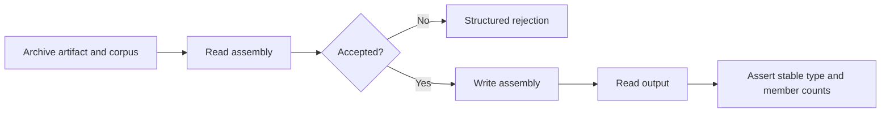

# fix-fuzz-roundtrip-2 - Plan

## Scope & Non-Goals

- Goal: Repair the exact roundtrip failure reported in the new archive.
- In scope: Responsible reader/writer logic, compact regression tests, and deterministic replay of 809 inputs.
- Non-goals: Broad metadata hardening, unrelated refactors, changes to the fuzz invariant, committing or pushing changes.
- The completed September roundtrip plan concerns a different crash. The open September metadata-hardening plan is a broad, unimplemented template; leave both untouched and track this specific repair separately.

## Acceptance Criteria

- [x] Reproduce and explain crash b42537c8597e3e31b946594e2e5fcda1def7e582.
- [x] Add deterministic coverage that fails before the fix and passes after it.
- [x] Replay all 809 supplied inputs with zero panics or roundtrip invariant failures.
- [x] Pass focused compatibility tests, formatting, and relevant lint checks.

## Assumptions & Constraints

- This checkout is cecli-rs, a Rust .NET assembly library, not the Bun repository described by the inherited parent instructions; use the Cargo commands defined in this repository.
- Preserve public APIs and the existing fuzz assertions. Invalid input may return a structured read error.
- Preserve pre-existing untracked .pi/, plan/, and archive files. Keep extracted artifacts and diagnostic tools under ignored tmp/.
- Windows Rust toolchain is available. Deterministic replay can verify the fuzz invariant without sanitizer instrumentation.
- Run safe, local, targeted checks automatically; do not start a costly mutation campaign or slow whole-suite run without approval.

## Baseline Tests

| Item | Command | Baseline result (at start) |
| --- | --- | --- |
| Commit / ref | git log -1 --oneline; git status --short | 134553e on main; no tracked changes |
| Archive inspection | Python zipfile inventory | 1 crash artifact (344064 bytes), 808 corpus entries |
| Reported crash | cargo run --offline -p cecli-cli -- roundtrip tmp/fuzz-roundtrip-20261002/artifacts/roundtrip/crash-b42537c8597e3e31b946594e2e5fcda1def7e582 | Fails on write: EXPLICIT_THIS requires HAS_THIS in a method signature |
| Full archive baseline | cargo run --offline --locked --manifest-path tmp/fuzz-roundtrip-20260912/tool/Cargo.toml --target-dir tmp/fuzz-roundtrip-20261002/target -- tmp/fuzz-roundtrip-20261002/artifacts tmp/fuzz-roundtrip-20261002/corpus | Fresh build confirms 809 inputs: 319 successful roundtrips, 489 read rejections, 1 failure (reported crash) |
| Focused signature tests | cargo test --offline --locked --target-dir tmp/fuzz-roundtrip-20261002/target -p cecli --lib model::signature::tests | After adding regression tests and before fix: 19 passed, 2 expected failures (top-level method and nested FnPtr) |
| Focused fixture tests | cargo test --offline --locked --target-dir tmp/fuzz-roundtrip-20261002/target -p cecli --test fixtures_roundtrip -- --nocapture | Fresh build: 7 actually executed and passed in 2.92s; initial old-target run skipped all due to stale embedded workspace path |

## Diagram

## Task Checklist

| ID | Task | Owner | Deps | Done |
| --- | --- | --- | --- | --- |
| T1 | Extract inputs and reproduce supplied crash | [main] | - | [x] |
| T2 | Locate existing regression harnesses and read/write entry points | [sub-agent] | - | [x] |
| T3 | Trace root cause and add a failing compact regression | [main] | T1, T2 | [x] |
| T4 | Implement the narrow fix and pass focused tests | [main] | T3 | [x] |
| T5 | Replay archive, run compatibility and quality checks, review diff | [main] | T4 | [x] |
| T6 | Record verification and close plan | [main] | T5 | [x] |

## Sub-agent Registry

| Task ID | Agent Ref | Status | Integration | Owned Files | Checkpoint / Next Action | Updated |
| --- | --- | --- | --- | --- | --- | --- |
| T2 | roundtrip-map / 124b617a-7530-427 | completed | integrated | None (read-only) | Located MetadataBuilder + ImageWriter in-memory regression pattern, counts helpers, reader/writer entry points; no edits | 2026-10-02 21:29 |

## Risks & Rollback

| Risk | Likelihood / Impact | Mitigation | Rollback |
| --- | --- | --- | --- |
| Rejecting valid metadata | Medium / medium | Cover valid edge cases and run fixture roundtrips | Revert only this repair's edits |
| Additional archive failures | Medium / medium | Replay every input before and after fix | Keep repairs scoped to reproduced failures |

## Blockers

None.

## Change Log

| Time (YYYY-MM-DD HH:mm) | Task ID | File / Task | Change | By |
| --- | --- | --- | --- | --- |
| 2026-10-02 21:26 | T1 | Archive and plan triage | Identified one new crash and 808 corpus entries; reconciled prior plans and clean tracked baseline; created this scoped plan | main |
| 2026-10-02 21:29 | T1 | Extraction and baseline replay | Extracted all 809 inputs under ignored tmp/fuzz-roundtrip-20261002; original crash reads but writing rejects EXPLICIT_THIS without HAS_THIS; exact fuzz-invariant replay finds no other failures | main |
| 2026-10-02 21:29 | T2 | Read-only test/helper map | Reviewed search results for existing MetadataBuilder/PE-carrier tests and module read/write entry points; no source changes | roundtrip-map (reviewed by main) |
| 2026-10-02 21:34 | T3 | Signature codec and validation environment | Shared get_method_signature decodes EXPLICIT_THIS without validating HAS_THIS; put_method_signature already rejects it. Found stale compiled fixture path in existing target, so use fresh tmp/fuzz-roundtrip-20261002/target for reliable baseline and verification. Added ignored raw-signature inspection probe | main |
| 2026-10-02 21:34 | T3 | Artifact inspection and tests | Artifact MethodDef RID 1423 (Mono.Cecil.MethodDefinition::get_IsVirtual) references blob 0x3f21 beginning 0x40. Added three signature codec tests: malformed method flags, nested FnPtr, and valid flag combinations. Fresh pre-fix run: 19 passed, 2 expected failures; fresh full archive baseline confirmed | main |
| 2026-10-02 21:35 | T4 | crates/cecli/src/model/signature.rs | Added BadImage guard for EXPLICIT_THIS without HAS_THIS in shared get_method_signature; focused suite now 21/21 passed. Production fix is three lines; writer validation and fuzz assertions are unchanged | main |
| 2026-10-02 21:36 | T5 | Full validation and final diff | All 809 inputs replayed: 319 successful roundtrips, 490 structured read rejections, 0 failures. 275 library and 12 integration tests passed in fresh target; Clippy, formatting, whitespace checks passed. Original crash independently confirmed rejected during read. Diff is one source file, 44 insertions (3 production lines plus 3 tests) | main |
| 2026-10-02 21:36 | T6 | Plan and summary | Recorded evidence and sanitizer limitation; no commits or pushes; unrelated plans, archives, and untracked files preserved | main |

## Verification Evidence

All commands ran from D:/cecli-rs. T below means the fresh target directory D:/cecli-rs/tmp/fuzz-roundtrip-20261002/target; no final checks rely on the stale original target/ artifacts.

| Time | Command | Result | Notes (regression vs. pre-existing) |
| --- | --- | --- | --- |
| 2026-10-02 21:34 | cargo test --offline --locked --manifest-path D:/cecli-rs/Cargo.toml --target-dir T -p cecli --lib model::signature::tests | Before fix: 19 passed, 2 failed as expected | Both regressions returned invalid models instead of BadImage |
| 2026-10-02 21:35 | cargo test --offline --locked --manifest-path D:/cecli-rs/Cargo.toml --target-dir T -p cecli --lib model::signature::tests | After fix: 21 passed | Includes valid combinations and nested FnPtr preservation |
| 2026-10-02 21:35 | cargo run --offline --locked --manifest-path D:/cecli-rs/tmp/fuzz-roundtrip-20260912/tool/Cargo.toml --target-dir T -- D:/cecli-rs/tmp/fuzz-roundtrip-20261002/artifacts D:/cecli-rs/tmp/fuzz-roundtrip-20261002/corpus | 809 inputs: 319 roundtrips, 490 read rejections, 0 failures | Same invariant as fuzz target. Logs in baseline-replay.log and fixed-replay.log under new temporary work directory |
| 2026-10-02 21:35 | cargo test --offline --locked --manifest-path D:/cecli-rs/Cargo.toml --target-dir T -p cecli --lib | 275 passed | Freshly compiled fixture path points at this checkout |
| 2026-10-02 21:35 | cargo test --offline --locked --manifest-path D:/cecli-rs/Cargo.toml --target-dir T -p cecli --test member_maps --test fixtures_roundtrip -- --nocapture | 12 passed: 7 fixture tests, 5 map regressions | Fixture suite actually executed; no missing-directory skips |
| 2026-10-02 21:35 | cargo clippy --offline --locked --manifest-path D:/cecli-rs/Cargo.toml --target-dir T -p cecli --all-targets -- -D warnings | Passed | No warnings |
| 2026-10-02 21:35 | cargo fmt --manifest-path D:/cecli-rs/Cargo.toml --all --check | Passed | No formatting changes required |
| 2026-10-02 21:36 | cargo run --offline --locked --manifest-path D:/cecli-rs/tmp/fuzz-roundtrip-20261002/probe/Cargo.toml --target-dir T -- D:/cecli-rs/tmp/fuzz-roundtrip-20261002/artifacts/roundtrip/crash-b42537c8597e3e31b946594e2e5fcda1def7e582 | Original artifact now returns BadImage: EXPLICIT_THIS requires HAS_THIS in a method signature | No writer failure or panic |
| 2026-10-02 21:36 | git -C D:/cecli-rs diff --check; git -C D:/cecli-rs diff --stat | Passed; one source file, 44 insertions | Three production lines, three regression tests; pre-existing untracked files preserved |

## Bug & Fix Log

| Time | Symptom | Root cause | Fix (files) | Guard added (test/assert/check) |
| --- | --- | --- | --- | --- |
| 2026-10-02 21:36 | Reader accepts fuzz artifact but writer errors on EXPLICIT_THIS without HAS_THIS | get_method_signature decoded both flags without checking their dependency; put_method_signature already checked it. Artifact MethodDef 1423 has header 0x40 | crates/cecli/src/model/signature.rs:306 rejects invalid flags as BadImage in the shared decoder, covering embedded FnPtr signatures too | Three codec tests cover invalid conventions/generic flag, nested FnPtr, and all three valid this-flag combinations; exact archive replay is clean |

## Completion Summary

Fixed the supplied roundtrip failure with a three-line validation guard in the shared method-signature decoder. Malformed EXPLICIT_THIS-without-HAS_THIS signatures now fail at read time with BadImage rather than producing unwritable models. The writer, public API, and fuzz invariant remain unchanged. Three deterministic unit tests cover top-level methods, nested function pointers, and valid flag combinations; both negative regressions were observed failing before the fix.

Verification is complete for the scoped repair: all 809 supplied inputs replayed without failure, 287 relevant library/integration tests passed, and Clippy, formatting, and whitespace checks passed. Existing target artifacts embedded a stale fixture directory, so verification used a fresh build directory and confirmed fixture tests actually ran. No new sanitizer-instrumented mutation campaign or whole-workspace/feature-matrix suite was run; replay was deterministic on Windows. Original archive and unrelated plans/files remain untouched. No commit or push was requested or performed.

## Next Steps

None; the scoped repair and verification are complete.
