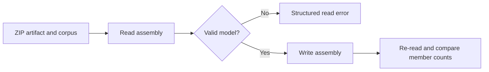

# fix-two-fuzz-roundtrip-archives - Plan

## Scope & Non-Goals

Repair crash-c85726c02e905344eab3eaa559934d2ff1868df9 from fuzz-roundtrip.zip and crash-e44095b430ff73f467cf39df15b37114e5a4d77b from fuzz-roundtrip (1).zip. Include responsible codec logic and regression tests. Do not expand the unrelated open metadata-hardening template, change public APIs, weaken fuzz assertions, commit, or push.

## Acceptance Criteria

- [x] Reproduce both reported failures.
- [x] Add compact regressions that fail before the fixes.
- [x] Fix both root causes and pass relevant compatibility tests.
- [x] Replay all 2304 inputs without panics or invariant failures; pass formatting and lint checks.

## Assumptions & Constraints

Preserve existing archives and unrelated files. Keep extraction and diagnostics in ignored tmp/fuzz-roundtrip-20261017. Use a fresh Cargo target to avoid stale artifacts recorded in previous work. Local reproduction and relevant regression checks are authorized by the requested repair. No mutation campaign or external service is required. All work is sequential and owned by main.

## Baseline Tests

| Item | Command | Baseline result (at start) |
| --- | --- | --- |
| Commit | git log -1 --oneline; git status --short | cad0067; no tracked changes |
| Artifact reproduction | cargo run --offline --locked --manifest-path tmp/fuzz-roundtrip-20260912/tool/Cargo.toml --target-dir tmp/fuzz-roundtrip-20261017/target -- tmp/fuzz-roundtrip-20261017/archive-0/artifacts tmp/fuzz-roundtrip-20261017/archive-1/artifacts | Both fail: missing System.Drawing assembly reference; catch clause without catch type |
| Corpus baseline | tmp/fuzz-roundtrip-20261017/target/debug/roundtrip-replay.exe tmp/fuzz-roundtrip-20261017/archive-0 tmp/fuzz-roundtrip-20261017/archive-1 | 2304 inputs: 859 successful roundtrips, 1443 read rejections, 2 failures; baseline-replay.log |

## Diagram

## Task Checklist

| ID | Task | Owner | Deps | Done |
| --- | --- | --- | --- | --- |
| T1 | Inspect plans, extract archives, reproduce artifacts | [main] | - | [x] |
| T2 | Trace both root causes and add failing regressions | [main] | T1 | [x] |
| T3 | Apply narrow fixes and pass focused tests | [main] | T2 | [x] |
| T4 | Replay corpus, run compatibility checks, review diff | [main] | T3 | [x] |
| T5 | Record evidence and close plan | [main] | T4 | [x] |

## Sub-agent Registry

No delegation.

| Task ID | Agent Ref | Status | Integration | Owned Files | Checkpoint / Next Action | Updated |
| --- | --- | --- | --- | --- | --- | --- |

## Risks & Rollback

| Risk | Likelihood / Impact | Mitigation | Rollback |
| --- | --- | --- | --- |
| Rejecting legal metadata | Medium / medium | Test valid adjacent cases and existing fixtures | Revert only task edits |
| Further corpus failures | Medium / medium | Replay every input before and after | Scope fixes to reproducible failures |

## Blockers

None.

## Change Log

| Time (YYYY-MM-DD HH:mm) | Task ID | File / Task | Change | By |
| --- | --- | --- | --- | --- |
| 2026-10-17 13:10 | T1 | Archive triage | Extracted 1170 + 1134 inputs after path validation; clean tracked baseline; both artifacts fail on write | main |
| 2026-10-17 13:12 | T2 | Initial diagnosis | Reader accepts NIL catch token while writer requires a type; investigating missing assembly reference | main |
| 2026-10-17 13:12 | T2 | Root cause probes | AssemblyRef row has RuntimeCompatibilityAttribute added after TypeRef scope clones; derived PartialEq includes attributes. ImportMethod RID 865 has Catch with NIL type token. Corpus baseline finds only the two artifacts failing | main |
| 2026-10-17 13:12 | T2 | tests/assembly_ref_attributes.rs | Added synthetic AssemblyRef custom-attribute roundtrip including an attribute constructor scoped to the annotated assembly | main |
| 2026-10-17 13:12 | T2 | read/instructions.rs tests | Added NIL catch rejection and valid Catch/Filter/Finally/Fault coverage in small and fat EH sections | main |
| 2026-10-17 13:12 | T2 | write/token_map.rs tests | Added scope lookup coverage that distinguishes public keys, versions and cultures while allowing attached custom attributes | main |
| 2026-10-17 13:13 | T2 | Pre-fix regressions | After correcting a missing test import: 276 library tests passed, two new tests failed as expected; new synthetic integration test failed with the exact System.Drawing error | main |
| 2026-10-17 13:13 | T3 | read/instructions.rs | Reject NIL catch token as BadImage before constructing a Catch with no type | main |
| 2026-10-17 13:13 | T3 | write/token_map.rs | Scope lookup compares all AssemblyRef row fields but excludes later-attached custom attributes; retained full-object PartialEq elsewhere | main |
| 2026-10-17 13:13 | T3 | Focused verification | All 278 library and 13 integration tests passed; formatted changes | main |
| 2026-10-17 13:15 | T4 | Corpus and quality checks | All 2304 inputs replayed: 860 roundtrips, 1444 read rejections, zero failures. Clippy, format, and whitespace checks pass; fixture log confirms no skips | main |
| 2026-10-17 13:15 | T5 | Final review and plan | Reviewed two source files plus one integration test (190 insertions, 7 deletions); recorded evidence and completion | main |

| 2026-10-17 13:16 | T5 | Authorized commit and push | Committed three repair/test files as d508c8c and pushed to origin/claude/fix-fuzz-roundtrip-this-flags; existing ZIP files and unrelated untracked files remain local | main |

## Verification Evidence

| Time | Command | Result | Notes (regression vs. pre-existing) |
| --- | --- | --- | --- |
| 2026-10-17 13:10 | Artifact reproduction command above | 2 failures | Both reported failures confirmed with freshly compiled current source |
| 2026-10-17 13:13 | cargo test --offline --locked --target-dir tmp/fuzz-roundtrip-20261017/target -p cecli --lib -- --quiet | Before fix: 276 pass, 2 expected failures | New NIL catch and scope-lookup regressions fail |
| 2026-10-17 13:13 | cargo test --offline --locked --target-dir tmp/fuzz-roundtrip-20261017/target -p cecli --test assembly_ref_attributes -- --nocapture | Before fix: 1 expected failure | Exact missing System.Drawing error reproduced without ZIP dependency |
| 2026-10-17 13:15 | cargo test --offline --locked --target-dir tmp/fuzz-roundtrip-20261017/target -p cecli --lib --test assembly_ref_attributes --test member_maps --test fixtures_roundtrip -- --nocapture | 291 passed (278 library + 13 integration), no skips | Log: tmp/fuzz-roundtrip-20261017/fixed-tests.log |
| 2026-10-17 13:15 | cargo run --offline --locked --manifest-path tmp/fuzz-roundtrip-20260912/tool/Cargo.toml --target-dir tmp/fuzz-roundtrip-20261017/target -- tmp/fuzz-roundtrip-20261017/archive-0 tmp/fuzz-roundtrip-20261017/archive-1 | 2304 inputs: 860 roundtrips, 1444 read rejections, 0 failures | Log: tmp/fuzz-roundtrip-20261017/fixed-replay.log; exact fuzz invariant, no sanitizer instrumentation |
| 2026-10-17 13:15 | cargo clippy --offline --locked --target-dir tmp/fuzz-roundtrip-20261017/target -p cecli --all-targets -- -D warnings | Passed | No lint warnings |
| 2026-10-17 13:15 | cargo fmt --all --check; git diff --check | Passed | No formatting or whitespace issues |

## Bug & Fix Log

| Time | Symptom | Root cause | Fix (files) | Guard added (test/assert/check) |
| --- | --- | --- | --- | --- |
| 2026-10-17 13:15 | Writer reports missing System.Drawing despite a matching AssemblyRef | TypeRef scopes cloned before custom-attribute attachment; full PartialEq includes attributes | write/token_map.rs compares reference fields excluding annotations | Scope-lookup identity test plus synthetic read/write/read test including self-scoped attribute constructor |
| 2026-10-17 13:15 | Writer rejects catch clause without catch type | Reader lets NIL Catch token become None | read/instructions.rs returns BadImage on NIL Catch token | Small/fat NIL rejection; valid Catch/Filter/Finally/Fault tests |

## Completion Summary

Both reported crashes are fixed. AssemblyRef annotations remain preserved and no longer prevent scope lookup. Malformed Catch clauses without a type are rejected during reading. Public APIs and fuzz assertions are unchanged.

All 2304 supplied inputs were replayed against freshly compiled source: 860 successful roundtrips, 1444 structured read rejections, zero failures. The only baseline failures were the two artifacts. Four new tests cover both bugs and nearby valid cases; all 291 relevant tests, Clippy, formatting, and whitespace checks pass. Validation was deterministic replay on Windows without a new mutation campaign or sanitizer instrumentation.

Existing archives and unrelated files remain intact. Following the user's commit+push request, committed the three repair/test files as d508c8c and pushed to origin/claude/fix-fuzz-roundtrip-this-flags. Extracted inputs, probes, and logs remain under ignored tmp/fuzz-roundtrip-20261017/.

## Next Steps

None; repair and verification are complete.
