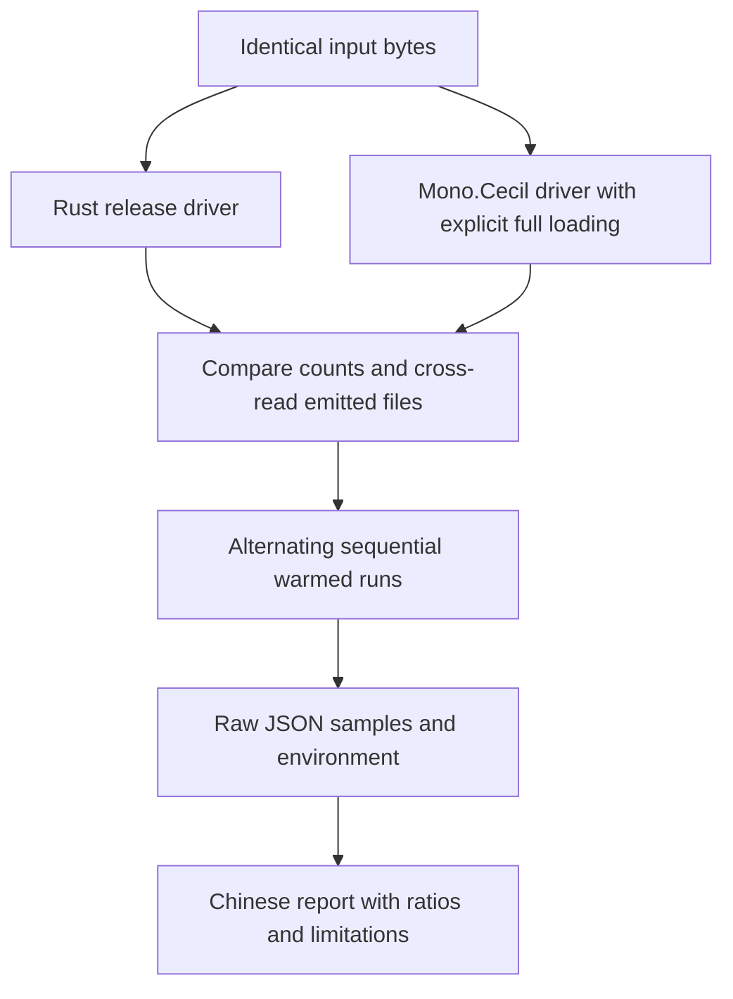

# compare-cecil-performance - Plan

## Scope & Non-Goals

- Goal: Measure comparable Rust and Mono.Cecil operations and deliver reproducible results.
- In scope: Benchmark drivers, runner, raw results, Chinese report.
- Follow-up: User requested the cause of large-file slowdown; profile and use a reversible isolated RVA-index experiment.
- Non-goals: Performance optimization or library behavior changes.

## Acceptance Criteria

- [x] Both drivers compile with optimization and run on the same input files.
- [x] Metadata and IL counts agree across implementations and after roundtrip.
- [x] Repeated warmed measurements cover read, write, and roundtrip across file sizes.
- [x] Raw data, environment, versions, caveats, and a Chinese report are saved.

## Assumptions & Constraints

- Mono.Cecil 0.11.6 from official NuGet; Roslyn 4.14.0 runs on local .NET 10.0.13.
- Memory-only workloads, no symbols or signing; full metadata and IL materialization.
- User explicitly authorized performance testing, including necessary downloads and repeated runs.
- Existing unrelated plans and untracked artifacts remain outside this task.

## Baseline Tests

| Item | Command | Baseline result (at start) |
| --- | --- | --- |
| Commit | git log -1 | d508c8cca9f3be36a9eefb165e9638ca9b1bee61 |
| Git | git status --short | Existing .pi/, ZIP archives and plan/ untracked |
| Toolchains | rustc -Vv; dotnet --info | Rust 1.97.1 x64 MSVC; .NET runtime 10.0.13, no SDK |
| Existing benchmarks | Read assembly.rs | Rust-only Criterion tests available; no comparison harness |

## Diagram

## Task Checklist

| ID | Task | Owner | Deps | Done |
| --- | --- | --- | --- | --- |
| T1 | Inspect API, versions and toolchains; define comparable workloads | `[main]` | - | [x] |
| T2 | Implement and compile both drivers | `[main]` | T1 | [x] |
| T3 | Add runner and report generation; verify count parity | `[main]` | T2 | [x] |
| T4 | Run repeated benchmarks and analyze results | `[main]` | T3 | [x] |
| T5 | Save report and verification evidence | `[main]` | T4 | [x] |
| T6 | Profile large-file writer and quantify quadratic RVA lookup in isolated build | `[main]` | T4 | [x] |

## Sub-agent Registry

No delegated work. All tasks owned by the main agent.

| Task ID | Agent Ref | Status | Integration | Owned Files | Checkpoint / Next Action | Updated |
| --- | --- | --- | --- | --- | --- | --- |

| T5 | baseline_report_wrapup | completed | integrated | benchmarks/20261023-cecil-baseline-summary.md only | Summarize existing 3-round baseline and isolated RVA experiment with explicit historical limits | 2026-10-23 |

## Risks & Rollback

| Risk | Likelihood / Impact | Mitigation | Rollback |
| --- | --- | --- | --- |
| Deferred reading distorts comparison | High / high | Force all metadata and IL; compare counts | Rework harness |
| Runtime and system noise | Medium / medium | Warmup, sequential alternating runs, repeated samples | Repeat affected cells |
| Write caches bias steady state | Medium / medium | Document repeated-model write and include roundtrip | Use roundtrip for single-use workloads |

## Blockers

None. Local Roslyn compiler avoids a system SDK installation.

## Change Log

| Time (YYYY-MM-DD HH:mm) | Task ID | File / Task | Change | By |
| --- | --- | --- | --- | --- |
| 2026-10-20 12:54 | T1 | Repository and toolchains | Checked APIs, existing bench and host | main |
| 2026-10-20 12:56 | T2 | scripts/compare-cecil/README.md | Documented workloads and constraints | main |
| 2026-10-20 12:58 | T2 | crates/cecli/examples/compare_cecil.rs | Rust full read/write/roundtrip driver and counts | main |
| 2026-10-20 12:58 | T2 | scripts/compare-cecil/CecilBench.cs | C# explicit full loading, counts and timings | main |
| 2026-10-20 13:03 | T3 | scripts/compare-cecil/run.ps1, report.py | Reproducible sequential runner, parity checks, raw JSON and Chinese reporting | main |
| 2026-10-20 13:05 | T3 | Benchmark inputs | Replaced R2R runtime DLLs rejected by Cecil writer with pure managed Roslyn DLLs | main |
| 2026-10-20 13:07 | T3 | CecilBench.cs, run.ps1, report.py | Added Roslyn dependency path, source hashes, reversing order each round, sample completeness assertions | main |
| 2026-10-20 13:26 | T4 | benchmarks/20261020-131630* | Finished 126 processes and 1386 samples; all sample/count assertions passed | main |
| 2026-10-20 13:27 | T4 | run.ps1, report.py, README.md | Added regex filters for independent follow-up measurements of noisy cells | main |
| 2026-10-20 13:35 | T6 | scripts/compare-cecil/experiment_rva.py | Isolated index build with exact source restoration; paired write timings and validation | main |

| 2026-10-23 | T5 | benchmarks/20261023-cecil-baseline-summary.md; RVA raw archive | Integrated historical three-round measurement and isolated O(MxB) RVA lookup diagnosis; report limitations retained | baseline_report_wrapup; reviewed main |

## Verification Evidence

| Time | Command | Result | Notes (regression vs. pre-existing) |
| --- | --- | --- | --- |
| 2026-10-20 12:58 | cargo build --release -p cecli --example compare_cecil | Passed | Benchmark-only code |
| 2026-10-20 13:04 | run.ps1 -ValidateOnly | Four fixture comparisons passed; System.Text.Json write rejected by upstream Cecil | Input selection issue, no library changes |
| 2026-10-20 13:05 | powershell -NoProfile -ExecutionPolicy Bypass -File scripts/compare-cecil/run.ps1 -ValidateOnly | All seven inputs, own roundtrips and both cross-read directions passed | Counts match metadata and all IL |
| 2026-10-20 13:26 | powershell -NoProfile -ExecutionPolicy Bypass -File scripts/compare-cecil/run.ps1 | Completed 3 rounds x 7 inputs x 3 modes x 2 implementations | Raw and report saved; individual round ranges warrant follow-up |
| 2026-10-20 13:18 | cargo clippy -p cecli --example compare_cecil -- -D warnings | Passed | No lint issues |

| 2026-10-23 | Inspect baseline/repeat/isolated raw samples and report links | 126/1386, 90/1350 and 18/270 process/sample records complete; copied experiment SHA256 matches | Historical source/count verification, not current semantic acceptance |

## Bug & Fix Log

| Time | Symptom | Root cause | Fix (files) | Guard added (test/assert/check) |
| --- | --- | --- | --- | --- |
| 2026-10-20 13:03 | Compiler rejected native runtime DLL references | Runtime folder includes native DLLs | run.ps1 explicit managed references | Successful compiler invocation |

## Completion Summary

Completed historical baseline and large-file writer diagnosis. Seven-input three-round baseline and five-input repeat retained. Isolated RVA indexing reduces CSharp write median from 700.232 to 284.783 ms (2.459x); other costs and noise remain. Chinese report saved at benchmarks/20261023-cecil-baseline-summary.md with exact raw links and historical count-only/provenance limits. Current optimization acceptance belongs to 20261021-130152-optimize-beyond-cecil.

## Next Steps

None for historical baseline; current optimization is tracked separately.
