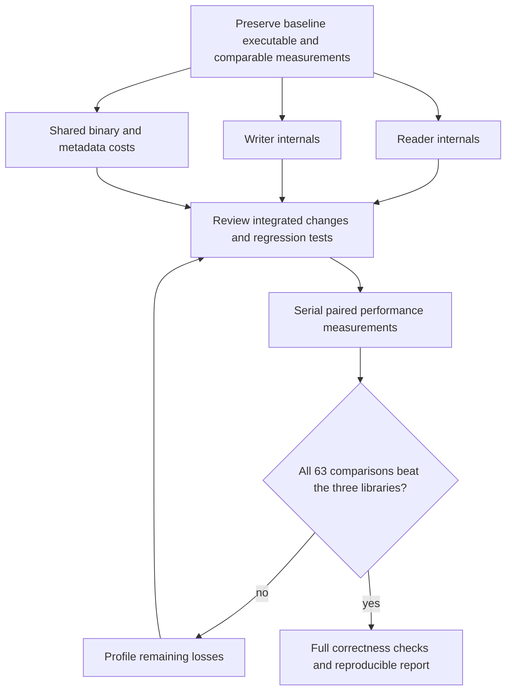

# optimize-beyond-cecil - Plan

## Scope & Non-Goals

- Goal: Improve actual library read/write performance until all seven inputs x three operations beat each of Mono.Cecil, dnlib and AsmResolver (63 pairwise comparisons).
- In scope: Parser, model construction and serialization internals; allocation reductions; reproducible benchmarks, regression guards and a Chinese results report.
- Non-goals: Universal claims about unmeasured inputs, changing benchmark workloads to favor Rust, skipping validation, or caching serialized outputs instead of performing writes.
- Scope update, user 2026-10-21 13:37: dnlib and AsmResolver are required competitors; unsafe, data structure changes and public API changes are explicitly authorized when they improve performance.
- Related prior work: 20261020-125457-compare-cecil-performance measured the baseline; its explicit non-goal was library optimization, so this is a new plan.

## Acceptance Criteria

- [x] Same inputs and full-load workloads remain comparable across four implementations; outputs pass independent semantic cross-reading.
- [x] Repeated alternating-process measurements show Rust faster in all seven inputs x read/write/roundtrip against each of the three competitors, with raw samples and environment saved.
- [x] Workspace tests, strongname tests, formatting and warning-clean Clippy pass; important serialization invariants receive regression coverage.
- [x] API changes are documented; malformed-input validation remains intact and unsafe invariants are checked; byte output changes are explained and checked.
- [x] Final Chinese report states per-case speedups, comparison conditions and measured limits honestly.

## Assumptions & Constraints

- Mono.Cecil 0.11.6, Roslyn 4.14.0, local Windows x64 and .NET 10.0.13; dependencies are already downloaded.
- User requested performance optimization and the comparison target; necessary local builds, tests and repeated benchmarks are authorized by this task.
- Preserve existing untracked artifacts, prior plans and comparison drivers. Do not overwrite historical benchmark results.
- Public API/data structure changes and unsafe optimizations are authorized by the user. Fix the new shared representation before adapting dependent readers/writers. Preserve malformed-input safety and document migration.
- Performance measurements run serially with no concurrent compilation or profiling; development tests may run independently when safe.
- Release CLI now defaults to mimalloc; the comparison driver uses the same explicit fast-allocator feature. Library consumers keep control of their global allocator. Record allocator/profile in every report; do not attribute configured-binary results to the system allocator.

## Baseline Tests

| Item | Command | Baseline result (at start) |
| --- | --- | --- |
| Commit | git rev-parse HEAD | d508c8cca9f3be36a9eefb165e9638ca9b1bee61 |
| Source | git diff; git status --short | No tracked modifications; existing benchmark drivers, scripts, results and plans untracked |
| Workspace | cargo test --workspace --locked --target-dir target/project-inspection --quiet | Prior turn: 439 tests including doctests passed |
| Strongname | cargo test -p cecli --features strongname --locked --target-dir target/project-inspection --quiet | Prior turn: 303 tests including doctests passed |
| Cache issue | Existing target/debug fixture tests | Stale compiled CARGO_MANIFEST_DIR points to old repository location; clean target succeeds |
| Performance | benchmarks/20261020-132609-cecil-comparison.raw.md | Small SQLite reads/writes lose; large Roslyn writes lose; fresh baseline pending |

## Diagram

## Task Checklist

| ID | Task | Owner | Deps | Done |
| --- | --- | --- | --- | --- |
| T1 | Audit workloads, preserve baseline, collect current timings and allocation profiles | `[main]` | - | [x] |
| T2 | Optimize writer internals with unchanged public signatures | `[sub-agent]` | T1 | [x] |
| T3 | Optimize reader internals with unchanged public signatures | `[sub-agent]` | T1 | [x] |
| T4 | Optimize shared core, PE, metadata and signature costs | `[main]` | T1 | [x] |
| T5 | Review and integrate changes; validate cross-reading and regressions | `[main]` | T2,T3,T4,T8 | [x] |
| T6 | Measure all 63 pairwise cells repeatedly and optimize remaining losses | `[main]` | T5,T9,T10 | [x] |
| T7 | Complete checks, document results, limitations and performance regression guards | `[main]` | T6 | [x] |
| T8 | Audit fair workloads and strengthen benchmark correctness/provenance | `[sub-agent]` | T1 | [x] |
| T9 | Add pinned dnlib/AsmResolver drivers, comparable full materialization and strict 63-comparison report | `[main]` | T8 | [x] |
| T10 | Design and integrate shared reference/model representation with documented API migration | `[main]` | T5 | [x] |
| T11 | Adapt reader/signature codecs to fixed Arc reference model and preserve independent mutation/depth checks | `[sub-agent]` | T10 | [x] |
| T12 | Adapt writer to fixed Arc model and optimize shared-reference encoding without changing output/classifier semantics | `[sub-agent]` | T10 | [x] |

## Sub-agent Registry

| Task ID | Agent Ref | Status | Integration | Owned Files | Checkpoint / Next Action | Updated |
| --- | --- | --- | --- | --- | --- | --- |
| T2 | writer_perf | completed | integrated | crates/cecli/src/write/*.rs | Reviewed RVA lookup, collision equality and callback-safe buffers; 41 writer tests pass; performance measurement next | 2026-10-21 13:23 |
| T3 | reader_perf | completed | integrated | crates/cecli/src/read/**/*.rs | Reviewed bounded TypeRef paths, cell identity, RVA fallback and calli capture; 34 reader tests pass | 2026-10-21 13:23 |
| T8 | benchmark_validation | completed | integrated | scripts/compare-cecil/* except experiment_rva.py; crates/cecli/examples/compare_cecil.rs | Reviewed unchanged timed workload, semantic cross-reading, archived provenance and strict 21-cell gate; development frozen | 2026-10-21 13:23 |
| T9 | benchmark_validation | superseded | integrated | scripts/compare-managed/* (new only) | Unavailable prior attempt completed in main thread after reconciliation; reviewed full-load drivers and runner. All seven inputs passed four-writer/two-reader semantic validation; final matrix next | 2026-10-22 13:24 |
| T11 | reader_perf | completed | integrated | cecli/src/read/*.rs; cecli/src/model/signature.rs | Reviewed Arc memo reuse, primitive canonical names and COW isolation; 35 reader + 22 signature tests passed | 2026-10-21 13:48 |
| T12 | writer_perf | completed | integrated | cecli/src/write/*.rs | Reviewed pinned Arc TypeRef RID cache restricted to immutable module; COW/other-module scopes covered; integrated workspace tests pass | 2026-10-21 13:48 |

## Risks & Rollback

| Risk | Likelihood / Impact | Mitigation | Rollback |
| --- | --- | --- | --- |
| Dedup/cache changes lose scope or signature identity | medium / high | Keep existing semantic keys; cross-reader validation and focused regressions | Revert only the relevant optimization patch |
| Parser speedup weakens hostile-input checks | medium / high | Preserve bounds/depth checks and fuzz regressions | Restore checked path |
| Noise overstates wins near parity | high / medium | Alternating order, warmed independent processes, repeated full matrix and uncertainty reporting | Retain raw measurements and make no unsupported pass claim |
| API/model layout changes break consumers | medium / high | Authorized by user; document migration and compile every workspace consumer; maintain independent mutation via Arc::make_mut | Restore only faulty representation change |

## Blockers

None.

## Change Log

| Time (YYYY-MM-DD HH:mm) | Task ID | File / Task | Change | By |
| --- | --- | --- | --- | --- |
| 2026-10-21 13:02 | T1 | This plan | Recorded scope, measurable target, existing tests and fixed file ownership | main |
| 2026-10-21 13:05 | T1 | target/perf-cecil/baseline; benchmarks/20261021-130344* | Preserved original executable, read/write allocation profiles and fresh 21-cell baseline with cross-reader validation | main |
| 2026-10-21 13:10 | T4 | crates/cecli-core/src/io.rs | Inline binary cursor operations across crate boundaries; add capacity-aware writer construction | main |
| 2026-10-21 13:10 | T4 | crates/cecli-metadata/src/builder.rs | Store contiguous table cells, precompute widths, reserve exact table bytes and eliminate temporary blob/user-string buffers | main |
| 2026-10-21 13:10 | T4 | crates/cecli-metadata/src/tables.rs | Share column/width buffers across tables and inline hot layout access; schema-buffer regression guard | main |
| 2026-10-21 13:10 | T4 | crates/cecli-metadata/src/reader.rs; heaps.rs | Inline hot accessors and add checked stack-backed row_array; verify row/schema bounds | main |
| 2026-10-21 13:17 | T4 | crates/cecli-metadata/src/root.rs | Reserve final metadata root and write padded names/version directly without scratch allocations | main |
| 2026-10-21 13:17 | T4 | crates/cecli/src/assembly.rs; cecli-pe/src/image.rs | Rebuild directly from header identity instead of serializing/parsing a dummy PE; preserve former path as byte-equivalence oracle | main |
| 2026-10-21 13:17 | T4 | crates/cecli/src/model/signature.rs; cecli-core/src/io.rs | Expose existing checked method-signature codec within crate and allow reusable byte-writer storage | main |
| 2026-10-21 13:17 | T4 | crates/cecli-metadata/src/reader.rs; tables.rs | Decode fixed-size rows with one row-bound check and cached sequential widths | main |
| 2026-10-21 13:23 | T2 | crates/cecli/src/write/*.rs | Integrated dense RVA lookup, fixed satellite rows, borrowed-key interning, indexed scope/value identity and reusable signature buffers | writer_perf; reviewed main |
| 2026-10-21 13:23 | T3 | crates/cecli/src/read/*.rs | Integrated bounded TypeRef paths, batch rows, exact capacities, compact RVA owners and single-pass deferred calli capture | reader_perf; reviewed main |
| 2026-10-21 13:23 | T8 | scripts/compare-cecil; examples/compare_cecil.rs | Added validation-only canonical metadata/IL fingerprints, bidirectional cross-reading, source/build archives and explicit per-cell repeated-round gate; timed operations unchanged | benchmark_validation; reviewed main |
| 2026-10-21 13:26 | T6 | Cargo.toml | Enable ThinLTO and one codegen unit in the actual release profile for cross-crate optimization; no CPU-specific target flags | main |
| 2026-10-21 13:32 | T6 | cecli-metadata/src/builder.rs | Deduplicate strings/blobs by owned heap ranges; complete-key collision chains eliminate a second allocation for each unique payload | main |
| 2026-10-21 13:32 | T6 | cecli-metadata/src/heaps.rs; cecli-pe/src/reader.rs | Decode UTF-16 without a temporary unit vector; parse stream names directly from checked input slices | main |
| 2026-10-21 13:32 | T6 | Cargo manifests/lock; cecli/src/lib.rs; cecli-cli/src/main.rs | Add opt-in allocator re-export without installing a library global allocator; actual CLI defaults to mimalloc with a no-default-features fallback | main |
| 2026-10-21 13:32 | T6 | comparison harness; README.md | Compare using the same configurable allocator as production CLI and record features/allocator explicitly; document system-allocator reproduction | main |
| 2026-10-21 13:40 | T10 | cecli/src/model/types.rs | User-authorized API change: immutable external type/method/field/scope identities and internal names now use Arc; generic argument slices and function pointers share ownership | main |
| 2026-10-21 13:40 | T6 | cecli-pe/src/writer.rs; cecli/src/write/*.rs | Reduce small-write setup: reserve PE headers, borrow resource/debug bytes, avoid unused patch-layout reconstruction and use bounded linear scope lookup for small modules | main |

| 2026-10-21 13:48 | T10 | importer/resolution/type system/parser/edit/removal/WinRT/Rocks/README | Adapt every consumer to Arc model; COW mutations preserve other owners; document API migration and allocator configuration | main |
| 2026-10-21 13:48 | T11 | cecli/src/read/*.rs; model/signature.rs | Share resolved external references/scopes/MethodSpecs and primitive names; pointer reuse plus independent mutation guards | reader_perf; reviewed main |
| 2026-10-21 13:48 | T12 | cecli/src/write/*.rs | Arc model adaptation and immutable-module pinned identity index for TypeRef tokens; full fallback validation retained | writer_perf; reviewed main |
| 2026-10-22 13:20 | T9 | Plan and scripts/compare-managed | Reconciled interrupted work with git and disk; no delegated agent remains live. Main agent resumes the remaining harness review, final checks and full comparison | main |
| 2026-10-22 13:24 | T9 | scripts/compare-managed/prepare.py; README.md | Integrated and documented pinned full-load drivers and strict 63-cell gate; record every managed dependency binary hash in addition to driver/source/package hashes | main |
| 2026-10-22 13:30 | T6 | benchmarks/20261022-132511-400411-managed-comparison.* | Discovery full matrix: all 63 comparisons win in the one measured round; semantic and source checks pass. Three rounds still required | main |
| 2026-10-22 13:32 | T7 | crates/cecli/src/write/token_map.rs | Reproduced and fixed signature-child cache leaking module-specific tokens and suppressing dynamic classifiers; scoped unbound caches to each immutable encoder view and bypassed bytes cache with classifiers; added two regression guards | main |
| 2026-10-22 13:36 | T7 | scripts/compare-managed/test_report.py; README files | Added eight acceptance-gate tests preventing single-cell/round losses, ties, filtered/incomplete samples, semantic failures and missing provenance from passing; documented strict benchmark reproduction in root README | main |
| 2026-10-22 13:36 | T7 | crates/cecli/src/write/token_map.rs | Kept pinned cache nodes in a named entry; classifier bypass tolerates nested callbacks while preserving errors. Existing reentrancy regression now encodes a composite primitive call site | main |

| 2026-10-23 19:25 | T6,T7 | Frozen-source final comparison | Strict gate passed all 63 comparisons in all three rounds; source freeze released for independently planned native work | main |

## Verification Evidence

| Time | Command | Result | Notes (regression vs. pre-existing) |
| --- | --- | --- | --- |
| 2026-10-21 13:02 | Baseline test evidence above | Passing in fresh target | Source unchanged before optimization |
| 2026-10-21 13:05 | run.ps1 -Rounds 1 -Samples 7 -SampleMs 60 -WarmupMs 400 | Completed seven-input matrix and cross-reading | Baseline: 4/21 Rust wins; short discovery run, not final acceptance |
| 2026-10-21 13:10 | cargo test --locked -p cecli-core -p cecli-metadata --target-dir target/project-inspection --quiet | Passed; metadata rerun with new guard: 15 tests passed | Shared-layer optimization checks |
| 2026-10-21 13:17 | cargo test --locked -p cecli direct_carrier_matches_parsed_carrier_output --target-dir target/project-inspection --quiet | Passed | Byte-identical output in 24 architecture/kind/resource combinations |
| 2026-10-21 13:23 | cargo test --workspace --locked --target-dir target/project-inspection --quiet | Passed at integration checkpoint | Additional final reader/writer guards separately pass (34 and 41); full final verification still required |
| 2026-10-21 13:23 | Preserved baseline vs phase1 release validate/write on all seven inputs | All seven outputs byte-identical | Original binary preserved under target/perf-cecil/baseline; optimized binary/output under phase1 |
| 2026-10-21 13:23 | Enhanced Rust/Cecil semantic own-output and bidirectional cross-read validation | All seven inputs passed | Different try-region groups normalize by boundaries; significant catch/filter precedence within a shared try region retained |
| 2026-10-21 13:26 | Phase1 full matrix: benchmarks/20261021-132231-764-cecil-comparison.* | 11/21 wins; target NOT achieved | All seven semantic checks pass; small reads/SQLite and small writes still lose; short discovery only |
| 2026-10-21 13:32 | ThinLTO-only small-input discovery: benchmarks/20261021-132630-739-cecil-comparison.* | 1/9 wins; target NOT achieved | Reducing compiler boundaries alone does not fix allocation costs; preserve this system-allocator evidence |

| 2026-10-21 13:48 | cargo test --workspace --all-features --locked --target-dir target/project-inspection --quiet | 462 tests including strongname and doctests passed | Arc integration checkpoint; final reader guards added subsequently |
| 2026-10-22 13:22 | cargo test --workspace --all-features --locked --target-dir target/project-inspection --quiet | All 464 tests including strongname and doctests passed | Reconciled current Arc reader/writer source and final guards |
| 2026-10-22 13:22 | cargo fmt --all --check | Passed | Current workspace source is formatted |
| 2026-10-22 13:23 | cargo clippy --workspace --all-targets --all-features --locked --target-dir target/project-inspection -- -D warnings | Passed | Includes examples, benches and all strongname/allocator consumers |
| 2026-10-22 13:23 | RUSTDOCFLAGS=-D warnings cargo doc --workspace --all-features --no-deps --locked --target-dir target/project-inspection | Passed | API documentation is warning-clean |
| 2026-10-22 13:24 | python -X utf8 scripts/compare-managed/run.py --validate-only --cargo-target-dir target/perf-cecil/phase1 | All seven inputs passed; all four writers cross-read by both independent semantic readers | Evidence: benchmarks/20261022-132159-810738-managed-comparison.environment.json |
| 2026-10-22 13:30 | python -X utf8 scripts/compare-managed/run.py --cargo-target-dir target/perf-cecil/phase1 --rounds 1 --samples 7 --sample-ms 60 --warmup-ms 600 | 63/63 median wins, 63/63 round wins; final gate correctly FAILS for fewer than three rounds | Discovery only; original data retained |
| 2026-10-22 13:32 | cargo test --locked -p cecli write::token_map --target-dir target/project-inspection --quiet | All 20 tests passed | New cache regressions both reproduced before the fix |
| 2026-10-22 13:36 | cargo test --workspace --all-features --locked --target-dir target/project-inspection --quiet | All 466 tests including strongname and doctests passed | Final cache scoping/classifier/reentrancy source |
| 2026-10-22 13:36 | python -X utf8 -m unittest discover -s scripts/compare-managed -p test_report.py | All eight tests passed | Acceptance cannot hide losses behind an average or insufficient validation |
| 2026-10-22 13:35 | cargo check --manifest-path fuzz/Cargo.toml --locked --bins | Passed | All six fuzz targets still compile against the Arc API |
| 2026-10-22 13:36 | cargo fmt --all --check; git diff --check | Passed | CRLF-aware git whitespace check |
| 2026-10-22 13:40 | cargo clippy --workspace --all-targets --all-features --locked --target-dir target/project-inspection -- -D warnings | Passed | Final cache and nested classifier source |
| 2026-10-22 13:40 | RUSTDOCFLAGS=-D warnings cargo doc --workspace --all-features --no-deps --locked --target-dir target/project-inspection | Passed | Final API docs |
| 2026-10-22 13:40 | cargo check -p cecli-cli --no-default-features --locked --target-dir target/project-inspection | Passed | CLI's documented system-allocator fallback compiles |

| 2026-10-23 | python -X utf8 scripts/compare-managed/run.py --cargo-target-dir target/perf-cecil/phase1 --rounds 3 --samples 11 --sample-ms 120 --warmup-ms 800 --require-all-cells | PASS: 63/63 medians and every paired round | benchmarks/20261023-185319-143072-managed-comparison.raw.acceptance.json; source provenance and semantic validation pass |

## Bug & Fix Log

| Time | Symptom | Root cause | Fix (files) | Guard added (test/assert/check) |
| --- | --- | --- | --- | --- |
| 2026-10-22 13:32 | Cached inline signature reused a prior module's cells and skipped classifier calls/errors | Cache keyed only the shared child address although encoding also depends on module and callback state | token_map.rs: cache epoch per unbound encoder, stable epoch only for immutably bound module; bypass with dynamic classifier | shared_signature_children_recheck_unbound_and_other_module_scopes; shared_signature_children_preserve_dynamic_classifier_calls |

## Completion Summary

Completed frozen-source performance acceptance: three serial rounds, 63/63 pooled-median wins and 63/63 every-round wins against Mono.Cecil 0.11.6, dnlib 4.5.0 and AsmResolver 6.0.1. All four outputs cross-read by two independent semantic readers on seven inputs; stable source archive and fresh release/mimalloc build provenance pass. Workspace 545 tests and lint/docs/feature/fuzz checks passed before timing. Evidence is for the archived source, prior to separately planned native PDB/append-only mixed metadata additions.

## Next Steps

No remaining work in this performance baseline; native additions proceed under plan/20261023-185423-native-pdb-writing-Plan.md.
