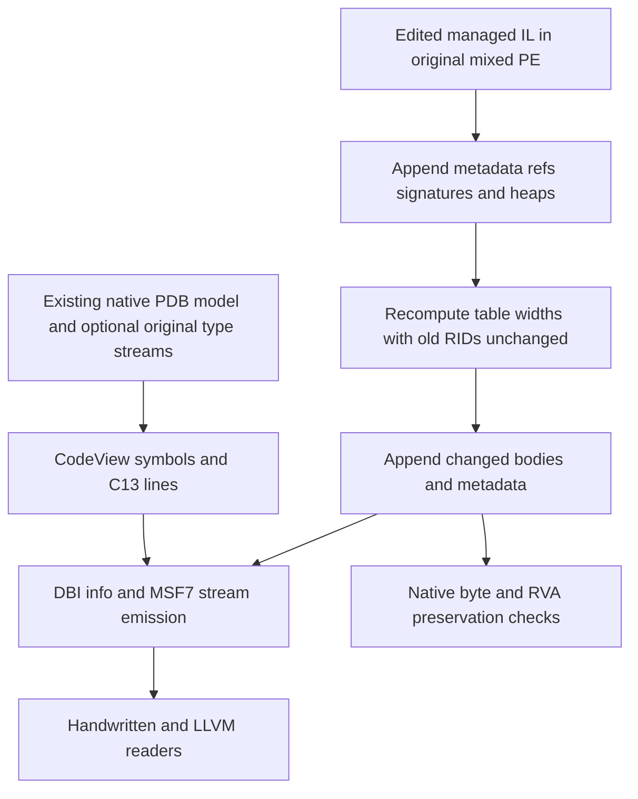

# Native PDB writing and practical mixed IL editing - Plan

## Scope & Non-Goals

User requested native PDB writing, then clarified that token-preserving mixed writes reject too many useful IL edits. Implement native MSF7/DBI/CodeView writer and append-only metadata editing for new IL operands/locals while retaining old token identity and native PE payload. Preserve unrelated edits. Development was staged under ignored tmp until the frozen performance benchmark finished and passed. No commit or push requested. Do not claim arbitrary native code relinking or missing type graph reconstruction.

## Acceptance Criteria

- [x] Native PDB builder emits MSF7, identity, DBI modules, managed/native procedures, lines, scopes, locals/constants and publics.
- [x] Emitted PDB reopens through handwritten reader and LLVM; real input reconstruction retains modeled debug information and available type streams.
- [x] Mixed IL edits can add required TypeRef/TypeSpec/MemberRef/MethodSpec/StandAloneSig rows and user strings with existing token/heap references preserved even across width changes.
- [x] New native PDB output integrates into facade; native PE payload preservation and safe edit constraints are tested.
- [x] Relevant tests, all-feature suite, formatting/Clippy/docs pass and support limits documented.

## Assumptions & Constraints

Existing reader models are fixed. No WinAPI, DIA or external PDB crate. LLVM 22.1.8 llvm-pdbutil is installed for independent validation. Keep TypeDef/MethodDef/Field token topology stable initially; additions to reference/signature tables are append-only. User authorizes necessary local build/test verification. Frozen-source benchmark passed before integration; archived source identifies that separate baseline.

## Baseline Tests

| Item | Command | Baseline result (at start) |
| --- | --- | --- |
| Current workspace | cargo test --workspace --all-features --locked --target-dir target/project-inspection --quiet | 545 pass |
| Quality | Clippy all features/targets; rustdoc -D warnings; fmt; fuzz bins | Pass |
| Native write | Source inspection | Native PDB reader only; mixed writer errors for new signature/reference metadata |
| Corpus | Final replay and dnlib comparison | 3113 inputs zero failures; 1247 cases zero cecli panics |

## Diagram

## Task Checklist

| ID | Task | Owner | Deps | Done |
| --- | --- | --- | --- | --- |
| T1 | Reconcile scope and freeze contracts/staged ownership | [main] | - | [x] |
| T2 | MSF7 container and NativePdbBuilder/DBI identity emission | [sub-agent] | T1 | [x] |
| T3 | CodeView/C13 procedure scope local constant and line emission | [sub-agent] | T1 | [x] |
| T4 | Append-only mixed metadata and practical new IL operand editing | [sub-agent] | T1 | [x] |
| T5 | Integrate staged code after benchmark, facade PDB output and independent validation | [main] | T2,T3,T4 | [x] |
| T6 | Final quality checks and supported behavior documentation | [main] | T5 | [x] |

## Sub-agent Registry

| Task ID | Agent Ref | Status | Integration | Owned Files | Checkpoint / Next Action | Updated |
| --- | --- | --- | --- | --- | --- | --- |
| T2 | native_container_writer | failed | integrated | tmp/native-writing/container/** | Staged work recovered by replacement; no duplicate implementation | 2026-10-23 |
| T2 | native_container_finish | completed | integrated | native/writer.rs, msf_writer.rs and mod.rs; native_pdb_rebuild example | 83 PDB tests, package Clippy, all 11 LLVM structure/line/type/public validations pass | 2026-10-23 |
| T3 | native_codeview_writer | completed | integrated | native/codeview_writer.rs; portable_writer.rs codec guard | 8 native encoder tests; exact 11-fixture models; 9 portable writer tests and Clippy pass | 2026-10-23 |
| T4 | mixed_metadata_writer | failed | integrated | tmp/native-writing/mixed/** | Staged work recovered by replacement; no duplicate implementation | 2026-10-23 |
| T4 | mixed_metadata_finish | completed | integrated | mixed_mode.rs, mixed_metadata.rs and mixed_mode_metadata.rs tests | 21 mixed tests plus width guard; four dnlib eager reads pass; read-only root facade review underway | 2026-10-23 |

## Risks & Rollback

| Risk | Likelihood / Impact | Mitigation | Rollback |
| --- | --- | --- | --- |
| Writer recognized only by our reader | High / high | LLVM validation and actual real fixture symbol comparison | Retain explicit limitations; fix format |
| New table widths change old references | High / high | Decode/reencode every physical row keeping numeric RIDs and heap offsets | Reject damaged original metadata |
| Native debug type indices need original TPI/IPI | High / high | Preserve original raw type streams in from_pdb builder | Reject unsupported inferred types |

## Blockers

None. Frozen performance acceptance passed 63/63 medians and every round; freeze lifted before source integration.

## Change Log

| Time (YYYY-MM-DD HH:mm) | Task ID | File / Task | Change | By |
| --- | --- | --- | --- | --- |
| 2026-10-23 18:58 | T1 | Scope and interfaces | Incorporated native PDB writer and fewer mixed IL Unsupported cases; staged ownership respects benchmark freeze | main |

| 2026-10-23 19:06 | T2 | Native container staged handoff | Agent reached rate limit after staging writer/MSF sources; root reconciled staged result before replacement integration, no duplicate implementation | main |
| 2026-10-23 | T2 | native/writer.rs, msf_writer.rs, mod.rs, example | Integrated MSF7 dual FPM, DBI/info/GSI/PSI/EC streams; retained native signatures and original TPI/IPI; fixed empty hash stream interoperability | native_container_finish; reviewed main |
| 2026-10-23 | T3 | native/codeview_writer.rs | Emitted procedures/scopes/locals/constants/imports/C13/publics; retained source/public ordering and managed/native address distinctions | native_codeview_writer; reviewed main |
| 2026-10-23 | T4 | mixed_mode.rs, mixed_metadata.rs, mixed tests | Appended refs/signatures/helpers, reencoded widened indices retaining old numeric rows/heaps/native bytes; validated raw tokens and helper ownership | mixed_metadata_finish; reviewed main |
| 2026-10-23 | T5 | assembly.rs, module_def.rs, lib.rs, native_symbols.rs, native_pdb_write.rs | Integrated NativePdb exact image sidecar, RSDS/checksum, updated local signature tokens, mixed Portable/Embedded/MDB output; native sections/addresses verified | main |
| 2026-10-23 | T5 | portable_writer.rs; assembly.rs conversion | Guarded reserved zero-width visible sentinel; normalized CodeView line-only and duplicate-address records for Portable conversion | main; native_codeview_writer |
| 2026-10-23 | T6 | README.md and crate docs | Updated support matrix, native limitations, offset contract, example and frozen baseline provenance | main |
| 2026-10-23 | T5 | native_symbols.rs; assembly.rs; native_pdb_write.rs | Review fixes: use final managed local signature allocations, deterministic new cache identity, sidecar path collision rejection before writes | main; reviewed mixed_metadata_finish |
| 2026-10-23 | T6 | native test output paths | Placed test artifacts in ignored root target/harden; moved earlier generated output into ignored archive without deleting it | main |
| 2026-10-23 | T6 | benchmarks/20261023-native-writing-summary.md | Recorded final Chinese API/support matrix, actual checks, LLVM caveat, native/signature constraints and separate frozen benchmark provenance | main |

## Verification Evidence

| Time | Command | Result | Notes (regression vs. pre-existing) |
| --- | --- | --- | --- |
| 2026-10-23 | Baseline evidence above | Pass | Before native writer work |
| 2026-10-23 | cecli-pdb package tests and all-target Clippy | 83 tests pass; -D warnings pass | Subsequent portable codec guard adds one test |
| 2026-10-23 | Mixed targeted suites; numeric widening guard | 21 integration tests and 1 unit pass | New refs/locals/calli/MethodSpec/catch/helpers, wrong token classes and unchanged abstract/PInvoke bodies |
| 2026-10-23 | dotnet target/harden/DnlibProbe.dll eager reads | Four output fixtures accepted | target/harden/mixed-metadata-dnlib-20261023.log |
| 2026-10-23 | llvm-pdbutil dump --summary --modules --files -l --publics --types --ids | All 11 rebuilt fixtures pass | 10 full symbols dumps pass; ComplexPdb hits APSInt on original too |
| 2026-10-23 | cargo test -p cecli --test native_pdb_write --all-features --locked --target-dir target/project-inspection | Seven tests pass | Native byte/RSDS/checksum/lines/final local-token identity, mixed format conversions, new identity and sidecar collision guard |
| 2026-10-23 | cargo clippy --workspace --all-targets --all-features --locked --target-dir target/project-inspection -- -D warnings | Pass | target/harden/native-final-clippy-20261023.log |
| 2026-10-23 | cargo test --workspace --all-features --locked --target-dir target/project-inspection --quiet | 577 passed; zero failed/ignored | target/harden/native-final-workspace-20261023.log; includes strongname and doctests |
| 2026-10-23 | rustdoc -D warnings; fmt; whitespace; CLI no-default-features; fuzz --bins | All pass | native-final-docs, cli, fuzz logs; six fuzz targets compile |
| 2026-10-23 | llvm-pdbutil full dump on final EditedMixed and ManagedLocals outputs | Pass | llvm-native-facade-20261023.txt; llvm-managed-native-facade-20261023.txt |
| 2026-10-23 | dotnet target/harden/DnlibProbe.dll on six facade outputs | All accepted | native-facade-dnlib-20261023.log |
| 2026-10-23 | Rebuilt roundtrip-replay on final source, three supplied archives | 3113 inputs; 2450 roundtrips; 663 read rejections; zero failures | target/harden/native-final-roundtrip-20261023.log |

## Bug & Fix Log

| Time | Symptom | Root cause | Fix (files) | Guard added (test/assert/check) |
| --- | --- | --- | --- | --- |
| 2026-10-23 | LLVM rejected modules without EC strings and empty public hashes | Readers tolerate missing auxiliary structures; LLVM requires them | Valid empty EC names and 16-byte empty GSI/PSI hashes | Empty/public-only and 11 corpus LLVM checks |
| 2026-10-23 | Native→Portable conversion misdecoded line-only records | Visible zero-width range collides with hidden sentinel, same-address source entries invalid in Portable | Normalize only native conversion; writer rejects unrepresentable visible ranges | Public writer roundtrip and actual mixed conversion tests |
| 2026-10-23 | New helper/renamed parameter edge failures | Combined bitflag contains, current vs original ParamList count | intersects and original method count | Helper rejection and old parameter rename plus helper tests |
| 2026-10-23 | Managed PDB locals can carry stale signature tokens after canonical rebuild | Read-time tokens differ from newly allocated StandAloneSig rows | Collect final TokenMap allocations before PDB assembly | ManagedLocals and ChangedLocals tests |
| 2026-10-23 | Rebuilt symbols can collide with original cache identity | Original GUID/age retained despite changed content | Deterministic SHA256 identity for facade PDB output and exact sidecar reuse | Changed identity and deterministic RSDS tests |
| 2026-10-23 | Output named .pdb overwrites PE with sidecar | Same path for image and symbol bytes | Reject path collision before any output writes | Preexisting file remains intact regression |

## Completion Summary

Implemented handwritten native PDB emission and practical append-only mixed IL metadata editing. Original native payload/RVAs and existing token/heaps remain preserved while new references, signatures, locals/calli/catches and ordinary top-level helpers can be added. Facade emits native sidecars with exact RSDS/checksum and final local-signature tokens; portable/embedded/MDB mixed symbol conversion is supported. Reconstructed native types/publics/lines are independently checked with LLVM and generated PEs with dnlib. Final 577 workspace tests, lint/docs/fmt/features/fuzz checks and 3113-input replay pass. Explicit residual support boundaries are documented: no arbitrary old definition/token relinking or native type/location graph synthesis, signed native modification, precompiled native-map reconstruction, automatic debug offset mapping or helper auxiliary metadata. ComplexPdb LLVM full-symbol dump has the same APSInt limitation in the original input; structure/type/public checks and exact model preservation pass. No commit or push requested or performed.

## Next Steps

No required work remains. Final report: benchmarks/20261023-native-writing-summary.md; performance baseline remains separately archived and verified.
