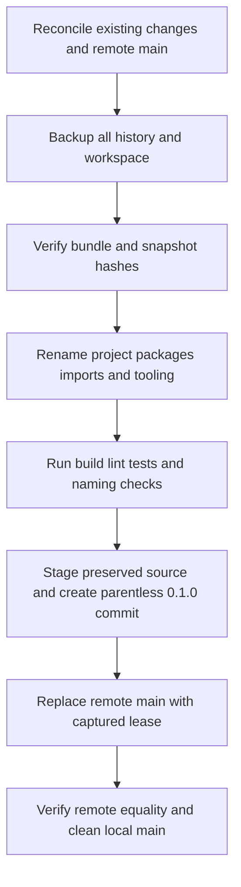

# Cecil Rust 0.1.0 history and naming - Plan

## Scope & Non-Goals

Preserve existing source changes and development records in one clean 0.1.0 root commit. Correct the project name to cecil-rs, publish the facade package as cecil-rs with the Rust library name cecil, and rename supporting packages, directories, imports, CLI, CI, and scripts to the cecil prefix. Replace the default remote main branch. Keep old history in local backup refs and an external Git bundle; preserve uncommitted inputs in a checked external snapshot. Historical measurements, their source archives, hashes, and completed plans retain their recorded names. No crate registry publication or GitHub release creation is requested.

## Acceptance Criteria

- [x] All existing Git refs and history are backed up and the bundle passes verification.
- [x] Tracked and untracked workspace inputs are backed up and SHA-256 checked before editing.
- [x] Current source, manifest paths, package names, imports, documentation, CLI and workflows consistently use the corrected names.
- [x] Required local verification passes after renaming.
- [x] One parentless commit describes completion of 0.1.0 development and includes the existing implementation changes.
- [x] Remote main equals the release commit after an explicit leased force push; local main is clean and tracks origin/main.

## Assumptions & Constraints

The user explicitly authorizes backup, committing existing changes, replacing prior commit history, force pushing, and renaming crates. Remote origin already points to https://github.com/hwyyds-skidder-team/cecil-rs.git. The main branch initially points to 28ea7f2f128918889ef4eae93a9879ae9eab05fc; the working branch initially points to d508c8cca9f3be36a9eefb165e9638ca9b1bee61. Existing completed plans record passing local builds and tests; necessary rename verification is part of preparing the requested commit. Local archives, Python caches and agent settings are preserved but excluded from source control. Do not rewrite original benchmark evidence. If main changes remotely before pushing, stop that push and reconcile rather than overwrite the newly discovered commit.

## Baseline Tests

| Item | Command | Baseline result (at start) |
| --- | --- | --- |
| Workspace | cargo test --workspace --all-features --locked --target-dir target/project-inspection --quiet | Existing final log: 577 pass, zero failures |
| Quality | Clippy all targets/features, rustdoc -D warnings, fmt, CLI without default features, fuzz bins | Existing native-final logs and completed native writer plan: pass |
| Fuzz replay | Three supplied roundtrip archives | Existing final log: 3113 inputs, zero failures |
| Git baseline | git status, git log, git ls-remote --symref origin, git fetch origin | Working changes reconciled; complete repository; remote main captured |

## Diagram

## Task Checklist

| ID | Task | Owner | Deps | Done |
| --- | --- | --- | --- | --- |
| T1 | Reconcile existing plan, working tree, local refs and default remote branch | [main] | - | [x] |
| T2 | Back up all refs and complete tracked/untracked inputs, verify backup | [main] | T1 | [x] |
| T3 | Relocate project and rename packages, imports, CLI, manifests, tooling and current documentation | [main] | T2 | [x] |
| T4 | Verify renamed workspace, features, documentation, scripts and commit contents | [main] | T3 | [x] |
| T5 | Create parentless release commit and move local main to it | [main] | T4 | [x] |
| T6 | Force push main with explicit lease, verify remote and close record | [main] | T5 | [x] |

## Sub-agent Registry

No delegation is needed. Existing completed plans have no unfinished delegated outcomes for this task.

| Task ID | Agent Ref | Status | Integration | Owned Files | Checkpoint / Next Action | Updated |
| --- | --- | --- | --- | --- | --- | --- |

## Risks & Rollback

| Risk | Likelihood / Impact | Mitigation | Rollback |
| --- | --- | --- | --- |
| Lost old commits or current uncommitted files | Low / high | Local backup branches, verified external bundle, complete workspace snapshot and binary patches | Restore refs from bundle and files from snapshot |
| Overwrite new remote changes | Low / high | Capture exact old main SHA and use force-with-lease=refs/heads/main:SHA | Reject changed remote main and reconcile |
| Renaming breaks package paths or doctests | Medium / medium | Cargo metadata, locked build/test/lint/docs/fuzz checks and reference search | Restore backed-up tree or fix naming references |
| Directory rename is blocked by the active Windows session | Observed / low | Move each verified immediate child to D:/cecil-rs using native PowerShell | All contents have moved; original occupied directory remains empty |

## Blockers

None. Repository content has moved to D:/cecil-rs. The original D:/cecli-rs directory is empty and still held open by the session.

## Change Log

| Time (YYYY-MM-DD HH:mm) | Task ID | File / Task | Change | By |
| --- | --- | --- | --- | --- |
| 2026-10-23 19:56 | T1 | Git state and existing plans | Reconciled existing source changes and completed checks; selected matching release plan; remote already named cecil-rs | main |
| 2026-10-23 20:01 | T2 | D:/cecil-rs-backups/20261023-200049 | Saved all Git refs/history, original index/config, binary patches, and 347-file snapshot; verified bundle and every snapshot SHA-256 | main |
| 2026-10-23 20:02 | T3 | Repository location | Direct directory rename was blocked by the Windows session; verified and moved every immediate child into D:/cecil-rs without deleting content | main |
| 2026-10-23 20:05 | T3 | Package naming contract | User explicitly included crate names; facade package cecil-rs/lib cecil, supporting cecil-* packages and CLI cecil | main |
| 2026-10-23 20:05 | T3 | .github/workflows/bench.yml | Corrected current package/import/path/tooling names; preserved implementation | main |
| 2026-10-23 20:05 | T3 | .github/workflows/ci.yml | Corrected current package/import/path/tooling names; preserved implementation | main |
| 2026-10-23 20:05 | T3 | Cargo.lock | Corrected current package/import/path/tooling names; preserved implementation | main |
| 2026-10-23 20:05 | T3 | Cargo.toml | Corrected current package/import/path/tooling names; preserved implementation | main |
| 2026-10-23 20:05 | T3 | README.md | Corrected current package/import/path/tooling names; preserved implementation | main |
| 2026-10-23 20:05 | T3 | crates/cecli-cil/Cargo.toml | Corrected current package/import/path/tooling names; preserved implementation | main |
| 2026-10-23 20:05 | T3 | crates/cecli-cil/src/body.rs | Corrected current package/import/path/tooling names; preserved implementation | main |
| 2026-10-23 20:05 | T3 | crates/cecli-cil/src/exceptions.rs | Corrected current package/import/path/tooling names; preserved implementation | main |
| 2026-10-23 20:05 | T3 | crates/cecli-cil/src/instruction.rs | Corrected current package/import/path/tooling names; preserved implementation | main |
| 2026-10-23 20:05 | T3 | crates/cecli-cil/src/lib.rs | Corrected current package/import/path/tooling names; preserved implementation | main |
| 2026-10-23 20:05 | T3 | crates/cecli-cil/src/variable.rs | Corrected current package/import/path/tooling names; preserved implementation | main |
| 2026-10-23 20:05 | T3 | crates/cecli-cli/Cargo.toml | Corrected current package/import/path/tooling names; preserved implementation | main |
| 2026-10-23 20:05 | T3 | crates/cecli-cli/src/main.rs | Corrected current package/import/path/tooling names; preserved implementation | main |
| 2026-10-23 20:05 | T3 | crates/cecli-core/Cargo.toml | Corrected current package/import/path/tooling names; preserved implementation | main |
| 2026-10-23 20:05 | T3 | crates/cecli-core/src/error.rs | Corrected current package/import/path/tooling names; preserved implementation | main |
| 2026-10-23 20:05 | T3 | crates/cecli-mdb/Cargo.toml | Corrected current package/import/path/tooling names; preserved implementation | main |
| 2026-10-23 20:05 | T3 | crates/cecli-mdb/src/lib.rs | Corrected current package/import/path/tooling names; preserved implementation | main |
| 2026-10-23 20:05 | T3 | crates/cecli-mdb/src/reader.rs | Corrected current package/import/path/tooling names; preserved implementation | main |
| 2026-10-23 20:05 | T3 | crates/cecli-mdb/src/writer.rs | Corrected current package/import/path/tooling names; preserved implementation | main |
| 2026-10-23 20:05 | T3 | crates/cecli-metadata/Cargo.toml | Corrected current package/import/path/tooling names; preserved implementation | main |
| 2026-10-23 20:05 | T3 | crates/cecli-metadata/src/builder.rs | Corrected current package/import/path/tooling names; preserved implementation | main |
| 2026-10-23 20:05 | T3 | crates/cecli-metadata/src/heaps.rs | Corrected current package/import/path/tooling names; preserved implementation | main |
| 2026-10-23 20:05 | T3 | crates/cecli-metadata/src/lib.rs | Corrected current package/import/path/tooling names; preserved implementation | main |
| 2026-10-23 20:05 | T3 | crates/cecli-metadata/src/reader.rs | Corrected current package/import/path/tooling names; preserved implementation | main |
| 2026-10-23 20:05 | T3 | crates/cecli-metadata/src/root.rs | Corrected current package/import/path/tooling names; preserved implementation | main |
| 2026-10-23 20:05 | T3 | crates/cecli-metadata/src/tables.rs | Corrected current package/import/path/tooling names; preserved implementation | main |
| 2026-10-23 20:05 | T3 | crates/cecli-pdb/Cargo.toml | Corrected current package/import/path/tooling names; preserved implementation | main |
| 2026-10-23 20:05 | T3 | crates/cecli-pdb/examples/native_pdb_rebuild.rs | Corrected current package/import/path/tooling names; preserved implementation | main |
| 2026-10-23 20:05 | T3 | crates/cecli-pdb/src/embedded.rs | Corrected current package/import/path/tooling names; preserved implementation | main |
| 2026-10-23 20:05 | T3 | crates/cecli-pdb/src/lib.rs | Corrected current package/import/path/tooling names; preserved implementation | main |
| 2026-10-23 20:05 | T3 | crates/cecli-pdb/src/native/codeview_writer.rs | Corrected current package/import/path/tooling names; preserved implementation | main |
| 2026-10-23 20:05 | T3 | crates/cecli-pdb/src/native/details.rs | Corrected current package/import/path/tooling names; preserved implementation | main |
| 2026-10-23 20:05 | T3 | crates/cecli-pdb/src/native/msf.rs | Corrected current package/import/path/tooling names; preserved implementation | main |
| 2026-10-23 20:05 | T3 | crates/cecli-pdb/src/native/msf_writer.rs | Corrected current package/import/path/tooling names; preserved implementation | main |
| 2026-10-23 20:05 | T3 | crates/cecli-pdb/src/native/symbols.rs | Corrected current package/import/path/tooling names; preserved implementation | main |
| 2026-10-23 20:05 | T3 | crates/cecli-pdb/src/native/writer.rs | Corrected current package/import/path/tooling names; preserved implementation | main |
| 2026-10-23 20:05 | T3 | crates/cecli-pdb/src/portable_reader.rs | Corrected current package/import/path/tooling names; preserved implementation | main |
| 2026-10-23 20:05 | T3 | crates/cecli-pdb/src/portable_writer.rs | Corrected current package/import/path/tooling names; preserved implementation | main |
| 2026-10-23 20:05 | T3 | crates/cecli-pe/Cargo.toml | Corrected current package/import/path/tooling names; preserved implementation | main |
| 2026-10-23 20:05 | T3 | crates/cecli-pe/src/buffer.rs | Corrected current package/import/path/tooling names; preserved implementation | main |
| 2026-10-23 20:05 | T3 | crates/cecli-pe/src/image.rs | Corrected current package/import/path/tooling names; preserved implementation | main |
| 2026-10-23 20:05 | T3 | crates/cecli-pe/src/reader.rs | Corrected current package/import/path/tooling names; preserved implementation | main |
| 2026-10-23 20:05 | T3 | crates/cecli-pe/src/testutil.rs | Corrected current package/import/path/tooling names; preserved implementation | main |
| 2026-10-23 20:05 | T3 | crates/cecli-pe/src/writer.rs | Corrected current package/import/path/tooling names; preserved implementation | main |
| 2026-10-23 20:05 | T3 | crates/cecli-rocks/Cargo.toml | Corrected current package/import/path/tooling names; preserved implementation | main |
| 2026-10-23 20:05 | T3 | crates/cecli-rocks/src/doccomment.rs | Corrected current package/import/path/tooling names; preserved implementation | main |
| 2026-10-23 20:05 | T3 | crates/cecli-rocks/src/ilparser.rs | Corrected current package/import/path/tooling names; preserved implementation | main |
| 2026-10-23 20:05 | T3 | crates/cecli-rocks/src/lib.rs | Corrected current package/import/path/tooling names; preserved implementation | main |
| 2026-10-23 20:05 | T3 | crates/cecli-rocks/src/reflect.rs | Corrected current package/import/path/tooling names; preserved implementation | main |
| 2026-10-23 20:05 | T3 | crates/cecli/Cargo.toml | Corrected current package/import/path/tooling names; preserved implementation | main |
| 2026-10-23 20:05 | T3 | crates/cecli/benches/assembly.rs | Corrected current package/import/path/tooling names; preserved implementation | main |
| 2026-10-23 20:05 | T3 | crates/cecli/examples/alloc_profile.rs | Corrected current package/import/path/tooling names; preserved implementation | main |
| 2026-10-23 20:05 | T3 | crates/cecli/examples/compare_cecil.rs | Corrected current package/import/path/tooling names; preserved implementation | main |
| 2026-10-23 20:05 | T3 | crates/cecli/examples/malformed_probe.rs | Corrected current package/import/path/tooling names; preserved implementation | main |
| 2026-10-23 20:05 | T3 | crates/cecli/examples/memberref_stats.rs | Corrected current package/import/path/tooling names; preserved implementation | main |
| 2026-10-23 20:05 | T3 | crates/cecli/examples/mixed_mode_edit.rs | Corrected current package/import/path/tooling names; preserved implementation | main |
| 2026-10-23 20:05 | T3 | crates/cecli/examples/timing.rs | Corrected current package/import/path/tooling names; preserved implementation | main |
| 2026-10-23 20:05 | T3 | crates/cecli/examples/write_profile.rs | Corrected current package/import/path/tooling names; preserved implementation | main |
| 2026-10-23 20:05 | T3 | crates/cecli/src/assembly.rs | Corrected current package/import/path/tooling names; preserved implementation | main |
| 2026-10-23 20:05 | T3 | crates/cecli/src/callgraph.rs | Corrected current package/import/path/tooling names; preserved implementation | main |
| 2026-10-23 20:05 | T3 | crates/cecli/src/diff.rs | Corrected current package/import/path/tooling names; preserved implementation | main |
| 2026-10-23 20:05 | T3 | crates/cecli/src/edit.rs | Corrected current package/import/path/tooling names; preserved implementation | main |
| 2026-10-23 20:05 | T3 | crates/cecli/src/flow.rs | Corrected current package/import/path/tooling names; preserved implementation | main |
| 2026-10-23 20:05 | T3 | crates/cecli/src/importer.rs | Corrected current package/import/path/tooling names; preserved implementation | main |
| 2026-10-23 20:05 | T3 | crates/cecli/src/index.rs | Corrected current package/import/path/tooling names; preserved implementation | main |
| 2026-10-23 20:05 | T3 | crates/cecli/src/lib.rs | Corrected current package/import/path/tooling names; preserved implementation | main |
| 2026-10-23 20:05 | T3 | crates/cecli/src/mixed_metadata.rs | Corrected current package/import/path/tooling names; preserved implementation | main |
| 2026-10-23 20:05 | T3 | crates/cecli/src/mixed_mode.rs | Corrected current package/import/path/tooling names; preserved implementation | main |
| 2026-10-23 20:05 | T3 | crates/cecli/src/model/custom_attribute.rs | Corrected current package/import/path/tooling names; preserved implementation | main |
| 2026-10-23 20:05 | T3 | crates/cecli/src/model/marshal.rs | Corrected current package/import/path/tooling names; preserved implementation | main |
| 2026-10-23 20:05 | T3 | crates/cecli/src/model/mod.rs | Corrected current package/import/path/tooling names; preserved implementation | main |
| 2026-10-23 20:05 | T3 | crates/cecli/src/model/removal.rs | Corrected current package/import/path/tooling names; preserved implementation | main |
| 2026-10-23 20:05 | T3 | crates/cecli/src/model/security.rs | Corrected current package/import/path/tooling names; preserved implementation | main |
| 2026-10-23 20:05 | T3 | crates/cecli/src/model/signature.rs | Corrected current package/import/path/tooling names; preserved implementation | main |
| 2026-10-23 20:05 | T3 | crates/cecli/src/model/substitution.rs | Corrected current package/import/path/tooling names; preserved implementation | main |
| 2026-10-23 20:05 | T3 | crates/cecli/src/model/types.rs | Corrected current package/import/path/tooling names; preserved implementation | main |
| 2026-10-23 20:05 | T3 | crates/cecli/src/module_def.rs | Corrected current package/import/path/tooling names; preserved implementation | main |
| 2026-10-23 20:05 | T3 | crates/cecli/src/native_symbols.rs | Corrected current package/import/path/tooling names; preserved implementation | main |
| 2026-10-23 20:05 | T3 | crates/cecli/src/read/context.rs | Corrected current package/import/path/tooling names; preserved implementation | main |
| 2026-10-23 20:05 | T3 | crates/cecli/src/read/instructions.rs | Corrected current package/import/path/tooling names; preserved implementation | main |
| 2026-10-23 20:05 | T3 | crates/cecli/src/read/module_reader.rs | Corrected current package/import/path/tooling names; preserved implementation | main |
| 2026-10-23 20:05 | T3 | crates/cecli/src/resolution.rs | Corrected current package/import/path/tooling names; preserved implementation | main |
| 2026-10-23 20:05 | T3 | crates/cecli/src/resolver.rs | Corrected current package/import/path/tooling names; preserved implementation | main |
| 2026-10-23 20:05 | T3 | crates/cecli/src/strongname.rs | Corrected current package/import/path/tooling names; preserved implementation | main |
| 2026-10-23 20:05 | T3 | crates/cecli/src/type_parser.rs | Corrected current package/import/path/tooling names; preserved implementation | main |
| 2026-10-23 20:05 | T3 | crates/cecli/src/type_system.rs | Corrected current package/import/path/tooling names; preserved implementation | main |
| 2026-10-23 20:05 | T3 | crates/cecli/src/winrt.rs | Corrected current package/import/path/tooling names; preserved implementation | main |
| 2026-10-23 20:05 | T3 | crates/cecli/src/write/emit_il.rs | Corrected current package/import/path/tooling names; preserved implementation | main |
| 2026-10-23 20:05 | T3 | crates/cecli/src/write/emit_metadata.rs | Corrected current package/import/path/tooling names; preserved implementation | main |
| 2026-10-23 20:05 | T3 | crates/cecli/src/write/resources.rs | Corrected current package/import/path/tooling names; preserved implementation | main |
| 2026-10-23 20:05 | T3 | crates/cecli/src/write/token_map.rs | Corrected current package/import/path/tooling names; preserved implementation | main |
| 2026-10-23 20:05 | T3 | crates/cecli/src/xref.rs | Corrected current package/import/path/tooling names; preserved implementation | main |
| 2026-10-23 20:05 | T3 | crates/cecli/tests/assembly_ref_attributes.rs | Corrected current package/import/path/tooling names; preserved implementation | main |
| 2026-10-23 20:05 | T3 | crates/cecli/tests/fixtures_roundtrip.rs | Corrected current package/import/path/tooling names; preserved implementation | main |
| 2026-10-23 20:05 | T3 | crates/cecli/tests/helpers/mod.rs | Corrected current package/import/path/tooling names; preserved implementation | main |
| 2026-10-23 20:05 | T3 | crates/cecli/tests/malformed_graphs.rs | Corrected current package/import/path/tooling names; preserved implementation | main |
| 2026-10-23 20:05 | T3 | crates/cecli/tests/member_maps.rs | Corrected current package/import/path/tooling names; preserved implementation | main |
| 2026-10-23 20:05 | T3 | crates/cecli/tests/mixed_mode.rs | Corrected current package/import/path/tooling names; preserved implementation | main |
| 2026-10-23 20:05 | T3 | crates/cecli/tests/mixed_mode_metadata.rs | Corrected current package/import/path/tooling names; preserved implementation | main |
| 2026-10-23 20:05 | T3 | crates/cecli/tests/native_pdb_write.rs | Corrected current package/import/path/tooling names; preserved implementation | main |
| 2026-10-23 20:05 | T3 | fuzz/Cargo.toml | Corrected current package/import/path/tooling names; preserved implementation | main |
| 2026-10-23 20:05 | T3 | fuzz/fuzz_targets/parse_mdb.rs | Corrected current package/import/path/tooling names; preserved implementation | main |
| 2026-10-23 20:05 | T3 | fuzz/fuzz_targets/parse_metadata.rs | Corrected current package/import/path/tooling names; preserved implementation | main |
| 2026-10-23 20:05 | T3 | fuzz/fuzz_targets/parse_native_pdb.rs | Corrected current package/import/path/tooling names; preserved implementation | main |
| 2026-10-23 20:05 | T3 | fuzz/fuzz_targets/parse_portable_pdb.rs | Corrected current package/import/path/tooling names; preserved implementation | main |
| 2026-10-23 20:05 | T3 | fuzz/fuzz_targets/read_assembly.rs | Corrected current package/import/path/tooling names; preserved implementation | main |
| 2026-10-23 20:05 | T3 | fuzz/fuzz_targets/roundtrip.rs | Corrected current package/import/path/tooling names; preserved implementation | main |
| 2026-10-23 20:05 | T3 | scripts/compare-cecil/README.md | Corrected current package/import/path/tooling names; preserved implementation | main |
| 2026-10-23 20:05 | T3 | scripts/compare-cecil/experiment_rva.py | Corrected current package/import/path/tooling names; preserved implementation | main |
| 2026-10-23 20:05 | T3 | scripts/compare-cecil/report.py | Corrected current package/import/path/tooling names; preserved implementation | main |
| 2026-10-23 20:05 | T3 | scripts/compare-cecil/run.ps1 | Corrected current package/import/path/tooling names; preserved implementation | main |
| 2026-10-23 20:05 | T3 | scripts/compare-managed/README.md | Corrected current package/import/path/tooling names; preserved implementation | main |
| 2026-10-23 20:05 | T3 | scripts/compare-managed/report.py | Corrected current package/import/path/tooling names; preserved implementation | main |
| 2026-10-23 20:05 | T3 | scripts/compare-managed/run.py | Corrected current package/import/path/tooling names; preserved implementation | main |
| 2026-10-23 20:05 | T3 | scripts/compare-managed/test_report.py | Corrected current package/import/path/tooling names; preserved implementation | main |
| 2026-10-23 20:05 | T3 | scripts/harden/DnlibProbe.cs | Corrected current package/import/path/tooling names; preserved implementation | main |
| 2026-10-23 20:05 | T3 | scripts/harden/compare.py | Corrected current package/import/path/tooling names; preserved implementation | main |
| 2026-10-23 20:05 | T3 | fuzz/Cargo.lock | Corrected current package/import/path/tooling names; preserved implementation | main |
| 2026-10-23 20:05 | T3 | crates/cecli -> crates/cecil-rs | Renamed crate directory without deleting contents | main |
| 2026-10-23 20:05 | T3 | crates/cecli-cil -> crates/cecil-cil | Renamed crate directory without deleting contents | main |
| 2026-10-23 20:05 | T3 | crates/cecli-cli -> crates/cecil-cli | Renamed crate directory without deleting contents | main |
| 2026-10-23 20:05 | T3 | crates/cecli-core -> crates/cecil-core | Renamed crate directory without deleting contents | main |
| 2026-10-23 20:05 | T3 | crates/cecli-mdb -> crates/cecil-mdb | Renamed crate directory without deleting contents | main |
| 2026-10-23 20:05 | T3 | crates/cecli-metadata -> crates/cecil-metadata | Renamed crate directory without deleting contents | main |
| 2026-10-23 20:05 | T3 | crates/cecli-pdb -> crates/cecil-pdb | Renamed crate directory without deleting contents | main |
| 2026-10-23 20:05 | T3 | crates/cecli-pe -> crates/cecil-pe | Renamed crate directory without deleting contents | main |
| 2026-10-23 20:09 | T3 | crates/cecli-rocks -> crates/cecil-rocks | Windows held the crate directory open; relocated validated contents and retained its empty old directory | main |
| 2026-10-23 20:09 | T3 | Cargo.toml | Use explicit corrected workspace members, including facade package cecil-rs with lib cecil | main |
| 2026-10-23 20:09 | T3 | .gitignore | Ignore local agent settings, Python caches and supplied repro ZIPs without deleting them | main |
| 2026-10-23 20:09 | T3 | README.md; crates/cecil-rs/src/lib.rs | Document 0.1.0 development completion, package/lib naming, matching examples and preserved historical measurements | main |
| 2026-10-23 20:09 | T3 | scripts/compare-managed/report.py; scripts/compare-cecil/report.py | Accept archived cecli-rs implementation labels and current cecil-rs labels without rewriting historical evidence | main |
| 2026-10-23 20:14 | T4 | Session recovery and repository reconciliation | Resumed rollout 01a1689e-4262-7c80-a875-9ccca7c4304e; verified actual repository moved to D:/cecil-rs, backup refs persist, remote main unchanged, no unfinished delegated tasks, and all current Rust/source edits predate the successful prior test run | main |
| 2026-10-23 20:16 | T4 | Backup and renamed workspace quality | Rechecked both backup-file SHA-256 hashes, all 347 snapshot entries, all mapped source inputs and backup refs; all-target/all-feature Clippy passes with zero warnings | main |
| 2026-10-23 20:18 | T4 | Documentation, CLI, fuzz and source preservation | Rustdoc with warnings denied, CLI system-allocator feature selection, and all six fuzz bins pass; compared pre-rename Rust files against snapshot and confirmed only corrected names/package references changed | main |
| 2026-10-23 20:21 | T4 | Exact staged release tree | Staged 338 files, reviewed rename-aware diff, checked every blob against the tested workspace, confirmed all 127 fixture blobs unchanged and excluded generated/local inputs; historical plan whitespace retained after snapshot confirmation | main |
| 2026-10-23 20:22 | T5 | Parentless release commit and local main | Created initial root commit 8c48e1d9277e with title release: complete cecil-rs 0.1.0 development; moved local main and HEAD without touching tested working files; set origin/main upstream, verified one commit, no parents and clean working tree | main |
| 2026-10-23 20:23 | T6 | Authorized remote history overwrite | Explicit lease on backed-up remote main accepted; pushed release root 34519649f694, verified remote/main/local equality, one-commit history and clean worktree; close recovery record and fold it into this same root | main |

## Verification Evidence

| Time | Command | Result | Notes (regression vs. pre-existing) |
| --- | --- | --- | --- |
| 2026-10-23 20:01 | git bundle create history-before-0.1.0.bundle --all; git bundle verify | Pass | External backup contains old main and working branch, plus all other refs |
| 2026-10-23 20:01 | SHA-256 comparison of every file in workspace-before-rename.zip | 347 files verified | Snapshot preserves all tracked and untracked inputs, including local supplied archives |
| 2026-10-23 20:09 | cargo metadata --no-deps --format-version 1 --locked --offline; same for fuzz/Cargo.toml | Pass: nine packages version 0.1.0, corrected package and target names; fuzz package cecil-fuzz | Recovered exact successful tool output from prior rollout |
| 2026-10-23 20:09 | cargo fmt --all --check; python -X utf8 -m unittest discover -s scripts/compare-managed -p test_report.py | Pass: format check and eight report tests | No source edits after these checks except plan updates |
| 2026-10-23 20:10 | SHA-256 historical inputs and archived report acceptance comparisons | Pass: 195 fixture/history files unchanged; four regenerated acceptance results exactly match recorded values | Archived failed benchmark attempts remain failed; final comparison remains passed |
| 2026-10-23 20:10 | PowerShell Parser::ParseFile for scripts/compare-cecil/run.ps1 and scripts/compare-managed/run.ps1 | Pass: both scripts parse | Recovered prior successful outputs |
| 2026-10-23 20:11 | cargo test --workspace --all-features --locked --offline --target-dir target/project-inspection --quiet | Pass: 577 tests; zero failed; process exit 0 | Recovered complete prior test output; checked latest source edit was 20:08:36 |
| 2026-10-23 20:14 | git ls-remote --symref origin HEAD refs/heads/main refs/heads/claude/fix-fuzz-roundtrip-this-flags | Pass: default branch main; main remains 28ea7f2f128918889ef4eae93a9879ae9eab05fc | Original captured main SHA is still valid for the authorized explicit lease |
| 2026-10-23 20:16 | git bundle verify; backup metadata SHA-256 comparisons; snapshot-entry and mapped workspace checks | Pass: bundle complete, two file hashes match, 347 snapshot entries verified, all 347 inputs preserved | Backup is unchanged and can restore old history and pre-rename workspace |
| 2026-10-23 20:16 | cargo clippy --workspace --all-targets --all-features --locked --offline --target-dir target/project-inspection -- -D warnings | Pass: exit 0, nine renamed crates | target/harden/release-rename-clippy-20261023-201515.log |
| 2026-10-23 20:16 | git candidate-tree input audit | 338 files; 10.7 MB; no build outputs, local agent settings or supplied repro ZIPs | Exact index-tree inspection remains before commit |
| 2026-10-23 20:18 | RUSTDOCFLAGS=-D warnings cargo doc --workspace --all-features --no-deps --locked --offline --target-dir target/project-inspection | Pass: exit 0 | target/harden/release-rename-docs-20261023-201633.log |
| 2026-10-23 20:18 | cargo check -p cecil-cli --no-default-features --locked --offline --target-dir target/project-inspection | Pass: exit 0 | target/harden/release-rename-cli-20261023-201633.log |
| 2026-10-23 20:18 | cargo check --manifest-path fuzz/Cargo.toml --bins --locked --offline --target-dir target/project-inspection | Pass: exit 0; all six fuzz targets | target/harden/release-rename-fuzz-20261023-201633.log |
| 2026-10-23 20:18 | Mapped snapshot comparison of every pre-existing Rust file | Pass: 92 renamed Rust inputs change only package/namespace/env-var/doc names; 224 total inputs byte-identical | No implementation loss during project/package relocation |
| 2026-10-23 20:18 | git -c core.autocrlf=false diff --check; plan.py check --strict | Pass: no whitespace errors; plan contract valid | Staged release-tree audit follows |
| 2026-10-23 20:21 | git add --all; git ls-files --stage; git cat-file --batch; git diff --cached --stat --find-renames | Pass: 338 files, 110 crate source files, 127 fixtures, 61 benchmark inputs, eight plans and 17 script inputs | Saved exact staged-file audit and rename-aware diff externally; all blobs equal workspace apart from three existing CRLF-normalized fixture source files |
| 2026-10-23 20:21 | git -c core.autocrlf=false -c core.whitespace=blank-at-eol,blank-at-eof,space-before-tab,cr-at-eol diff --cached --check -- . :!plan/20260912-222446-fix-fuzz-roundtrip-Plan.md | Pass: no source/current-plan whitespace errors | Only excluded finding is a historical plan blank line at EOF, byte-identical to backup; CRLF-aware check preserves original measurement bytes |
| 2026-10-23 20:22 | git commit-tree; git update-ref refs/heads/main; git symbolic-ref HEAD refs/heads/main; git rev-list --count main; git show -s --format=%P; git status --porcelain=v1 | Pass: parentless 0.1.0 root, count 1, clean local main tracking origin/main | Operation record and release message saved externally; plan-only amendments retain a single root commit |
| 2026-10-23 20:23 | git push --force-with-lease=refs/heads/main:28ea7f2f128918889ef4eae93a9879ae9eab05fc origin refs/heads/main:refs/heads/main | Pass: forced update, exit 0 | target main replaced only after backup/integrity checks; external release-force-push-initial.log |
| 2026-10-23 20:23 | git ls-remote origin refs/heads/main; git rev-parse HEAD origin/main; git rev-list --count main; git status --porcelain=v1 | Pass: remote and local equal 34519649f694, count 1, no working changes | Final plan-only amendment retains root history and uses an explicit lease on this pushed root; external release-operation.json records final hash |

## Bug & Fix Log

| Time | Symptom | Root cause | Fix (files) | Guard added (test/assert/check) |
| --- | --- | --- | --- | --- |
| 2026-10-23 20:02 | Root directory could not be renamed | Active Windows process holds the original directory | Move validated immediate children to the intended new root | Absolute source/destination checks and complete per-item success list |

## Completion Summary

Completed the requested 0.1.0 history consolidation and naming corrections. Main now contains one parentless commit titled `release: complete cecil-rs 0.1.0 development`, with all current implementation, fixtures, scripts, benchmark evidence and completed development plans. The project is located at D:/cecil-rs; the facade package is cecil-rs with library import cecil, supporting packages are cecil-*, and the CLI command is cecil. The remote repository already had the corrected name.

The complete pre-rewrite Git history and 347-file original workspace are preserved in D:/cecil-rs-backups/20261023-200049, along with local backup refs, original index/config, patches, checksums, the exact release-tree audit, push logs and release-operation.json. Historical measurements and completed plans keep their original content and labels. All original source inputs survive the rename; implementation changes relative to the snapshot are naming-only.

Verification passed: 577 all-feature workspace tests (including doctests), formatting, metadata, all-target/all-feature Clippy with warnings denied, all-feature rustdoc with warnings denied, CLI without default features, six fuzz target checks, eight benchmark-report tests, PowerShell parser checks and archived report acceptance/hash comparisons. Remote main and local main were verified equal with one commit and a clean worktree after the authorized explicit leased force push. A final plan-only amendment folds this completed record into the same root; the external operation record holds the definitive final commit hash and post-push verification without a self-referential commit hash in this file.

No implementation or verification work is deferred. Crates.io publication and a GitHub release were outside the request. The original D:/cecli-rs directory remains empty because the active Windows workspace holds it open; reopen D:/cecil-rs for future work. The original unmodified historical plan has one pre-existing blank line at EOF, intentionally retained after snapshot comparison.

## Next Steps

No further development action is required for this task. Use D:/cecil-rs as the workspace; consult D:/cecil-rs-backups/20261023-200049/release-operation.json for final push state and recovery identifiers.
