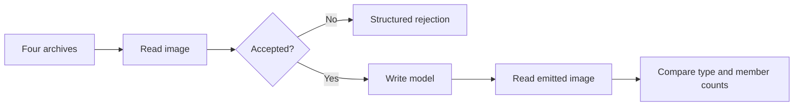

# Fix October 23 fuzz crashes and clippy - Plan

## Scope & Non-Goals

- Goal: Repair every reported fuzz failure and ensure warning-clean clippy checks.
- In scope: Four archives in D:/cecli-rs, responsible reader/writer code, deterministic regressions, corpus replay, workspace lint verification.
- Non-goals: Unrelated refactors, public API changes, modifying fuzz assertions.
- Follow-up scope: The user explicitly authorized committing these repairs, tests and this plan, then pushing to origin/main.

## Acceptance Criteria

- [x] Replay and explain all four crash artifacts; reproduce remaining corpus failures.
- [x] Add compact regression coverage for each root cause and pass the relevant compatibility tests.
- [x] Replay all 4,225 supplied inputs without panics or roundtrip invariant failures.
- [x] Pass workspace clippy for the CI feature sets with warnings denied, formatting, and whitespace checks.

## Assumptions & Constraints

- D:/cecli-rs contains only the new archives; the clean source checkout is D:/cecil-rs.
- Existing plans are completed and concern earlier artifacts; this plan tracks the new failures.
- Preserve existing files. Extracted corpora, probes, and verification logs live under ignored tmp/fuzz-roundtrip-20261023.
- Rust 1.97.1 and clippy 0.1.97 are installed on Windows; nightly Rust/clippy is 1.100. Full deterministic replay checks the exact fuzz invariant, and Linux AddressSanitizer checks the four artifacts plus both remaining corpus failures.
- The user's repair request authorizes necessary local builds, regressions, linting, and replay. Avoid unbounded fuzz campaigns.
- The main agent owns all edits; no delegation is needed.
- Resume reconciliation found a pre-existing four-line iterator fix in crates/cecil-metadata/src/builder.rs and completed baseline logs not yet reflected by this plan. Preserve that edit and validate it with the remaining nightly lints.

## Baseline Tests

| Item | Command | Baseline result (at start) |
| --- | --- | --- |
| Commit / ref | git status --short --branch; git rev-parse --short HEAD | Clean main at c7e6acc |
| Archive inventory | Python zipfile inspection and validated extraction | 1,173 + 1,102 + 1,056 + 894 = 4,225 entries; one crash in each archive |
| Clippy | cargo clippy --offline --locked --workspace --all-targets --all-features -- -D warnings | Passed, 17.69s; baseline-clippy.log |
| Crash reproduction | Fresh deterministic replay tool | All four supplied crash artifacts already pass on the current checkout; failures remain in two corpus entries |
| Reconciled artifact replay | cargo run --offline --locked --manifest-path tmp/fuzz-roundtrip-20261023/tool/Cargo.toml --target-dir target --bin oct23-roundtrip-replay -- artifacts | All four roundtrip successfully; current nil-catch/ownership recovery handles three and the fourth canonically rebuilds |
| Existing corpus baseline | baseline-corpus.log | 4225 inputs; 3318 successful roundtrips, 905 read rejections, two P/Invoke module-reference mismatches |
| Nightly clippy | baseline-clippy-nightly.log; clippy-nightly-pass2.log | needless_range_loop already edited; three chunks_exact_to_as_chunks warnings remain in native PDB code |

## Diagram

## Task Checklist

| ID | Task | Owner | Deps | Done |
| --- | --- | --- | --- | --- |
| T1 | Inspect checkout and archives; record baseline lint | [main] | - | [x] |
| T2 | Reproduce artifacts and establish corpus baseline | [main] | T1 | [x] |
| T3 | Diagnose roots, add regressions, and fix responsible code | [main] | T2 | [x] |
| T4 | Replay full corpus and run compatibility/lint checks | [main] | T3 | [x] |
| T5 | Review diff, record verification, and close plan | [main] | T4 | [x] |

## Sub-agent Registry

No delegated tasks.

| Task ID | Agent Ref | Status | Integration | Owned Files | Checkpoint / Next Action | Updated |
| --- | --- | --- | --- | --- | --- | --- |

## Risks & Rollback

| Risk | Likelihood / Impact | Mitigation | Rollback |
| --- | --- | --- | --- |
| Rejecting legitimate metadata | Medium / medium | Cover nearby valid encodings and fixture roundtrips | Revert only this task's changes |
| Additional corpus failures | Medium / medium | Replay every supplied input | Extend fixes only to reproduced roots |
| Different clippy warnings across toolchains/platforms | Medium / low | Check CI feature sets; inspect relevant cfg code and toolchains | Keep fixes compatible with MSRV 1.88 |

## Blockers

None.

## Change Log

| Time (YYYY-MM-DD HH:mm) | Task ID | File / Task | Change | By |
| --- | --- | --- | --- | --- |
| 2026-10-23 20:31 | T1 | Archive inventory and plan | Confirmed two directory roles, clean source checkout, and completed earlier plans; extracted all inputs after validating paths; workspace all-feature clippy baseline passes | main |
| 2026-10-23 20:54 | T1 | Resume reconciliation | Matched this active plan; reviewed existing iterator edit, replay tool, extraction and baseline logs; no unfinished delegated work. Fresh artifact replay confirms four successes; fresh corpus replay running | main |
| 2026-10-23 21:00 | T2 | Corpus and artifact diagnosis | Fresh full replay confirms 3318 roundtrips, 905 read rejections, two failures. Artifact d350 has invalid ownership/native passthrough; fccd already rebuilds normally; 3c1c and 781f have nil catch types handled by existing recovery. Detailed evidence in artifact-diagnosis.log | main |
| 2026-10-23 21:00 | T3 | tests/module_ref_names.rs | Added synthetic unterminated/invalid/truncated UTF-8 ModuleRef tests covering P/Invoke and TypeRef identity, canonical emission, strict rejection, valid ASCII/Unicode, and retained writer validation. Pre-fix test fails with an empty ModuleRef; two adjacent tests pass | main |
| 2026-10-23 21:00 | T3 | read/context.rs | Use policy-aware heap_name for ModuleRef pre-scan, preserving the same lossy identity as ImplMap and recording recovery diagnostics | main |
| 2026-10-23 21:00 | T3 | cecil-pdb/native/details.rs; writer.rs | Replace three fixed-size chunks_exact uses with as_chunks, retaining section/OMAP guards and hash remainder handling | main |
| 2026-10-23 21:02 | T3 | resolution.rs; winrt.rs | Further nightly clippy pass reports two cache range-loop lints and one needless bool; use enumerated module references and a direct negated predicate | main |
| 2026-10-23 21:02 | T3 | tests/module_ref_names.rs | All three regressions pass after the decoding fix; assert recovery diagnostics and original-image passthrough in addition to canonical name serialization | main |
| 2026-10-23 21:03 | T4 | Corpus and nightly lint | All 4225 supplied inputs replay with zero failures (3320 roundtrips, 905 read rejections); nightly workspace all-target/all-feature clippy passes with -D warnings | main |
| 2026-10-23 21:07 | T4 | Compatibility and stable lint | 580 workspace/all-feature tests pass, with zero failures, ignores or skip messages. Both CI stable clippy feature sets pass with -D warnings; format and whitespace checks pass | main |
| 2026-10-23 21:07 | T4 | Linux sanitizer replay | Fresh nightly AddressSanitizer roundtrip build succeeds; all four artifacts and the two corpus failures execute successfully using the actual unchanged fuzz target | main |
| 2026-10-23 21:07 | T5 | Final diff and plan | Reviewed six source files plus synthetic integration tests (154 lines); changes are scoped to ModuleRef decoding and seven clippy diagnostics. Recorded all evidence and completion | main |
| 2026-10-23 21:10 | T5 | Authorized commit and push preparation | User requested commit+push. Rechecked the complete diff and file inventory; fetched origin/main and confirmed it matches the repair base. Package the validated source, regression tests and plan in one commit | main |

## Verification Evidence

| Time | Command | Result | Notes (regression vs. pre-existing) |
| --- | --- | --- | --- |
| 2026-10-23 20:31 | cargo clippy --offline --locked --workspace --all-targets --all-features -- -D warnings | Passed | Original source, log tmp/fuzz-roundtrip-20261023/baseline-clippy.log |
| 2026-10-23 21:00 | target/debug/oct23-roundtrip-replay.exe four extracted archive directories | 4225 inputs; 3318 roundtrips, 905 rejections, two failures | Reconciled baseline; both failures are inconsistent ModuleRef recovery names |
| 2026-10-23 21:00 | cargo test --offline --locked -p cecil-rs --test module_ref_names -- --nocapture | Before fix: two pass, one expected failure | module-ref-pre-fix.log; initially corrected the test's ScopeRef variant typo before valid red run |
| 2026-10-23 21:02 | cargo test --offline --locked -p cecil-rs --test module_ref_names -- --nocapture | After fix: all three tests pass | module-ref-post-fix.log |
| 2026-10-23 21:03 | target/debug/oct23-roundtrip-replay.exe four extracted archive directories | 4225 inputs; 3320 roundtrips, 905 read rejections, zero failures | fixed-corpus.log; no mutation or sanitizer instrumentation |
| 2026-10-23 21:03 | cargo +nightly clippy --offline --locked --workspace --all-targets --all-features --target-dir target/nightly-clippy -- -D warnings | Passed | clippy-nightly-pass4.log; all reported new nightly lints fixed |
| 2026-10-23 21:07 | cargo test --offline --locked --workspace --all-features | 580 passed, zero failed/ignored | workspace-tests.log; includes fixture roundtrips, malformed ownership/nil catch, native PDB hash/OMAP, WinRT, resolution and all new ModuleRef tests; no skips |
| 2026-10-23 21:07 | cargo clippy --offline --locked --workspace --all-targets -- -D warnings | Passed | clippy-stable-default.log; CI default feature set |
| 2026-10-23 21:07 | cargo clippy --offline --locked --workspace --all-targets --features cecil-rs/strongname -- -D warnings | Passed | clippy-stable-strongname.log; CI signing feature set |
| 2026-10-23 21:07 | wsl -d archlinux --exec env PATH=/root/.cargo/bin:/usr/sbin:/usr/bin:/sbin:/bin CARGO_NET_OFFLINE=true cargo +nightly fuzz build roundtrip --codegen-units 16 | Passed | fuzz-build-linux.log; Linux nightly AddressSanitizer build against current source |
| 2026-10-23 21:07 | wsl -d archlinux --exec /mnt/d/cecil-rs/fuzz/target/x86_64-unknown-linux-gnu/release/roundtrip -rss_limit_mb=2560 -timeout=25 four artifacts and both corpus failures | Six inputs execute successfully, exit 0 | asan-artifacts.log; actual fuzz read/write/read invariant; fixed-input replay without a mutation campaign |
| 2026-10-23 21:07 | cargo fmt --all --check; git diff --check | Passed | No formatting or whitespace defects; existing Git LF/CRLF notices are informational |

## Bug & Fix Log

| Time | Symptom | Root cause | Fix (files) | Guard added (test/assert/check) |
| --- | --- | --- | --- | --- |
| 2026-10-23 21:07 | Corpus writer cannot find P/Invoke modules shelAsyncStat or an invalid-UTF-8 name | ImplMap uses lossy recovery decoding while ReadContext ModuleRef pre-scan turns strict heap errors into an empty name | read/context.rs uses policy-aware heap_name, preserving shared identity and recording diagnostics | tests/module_ref_names.rs covers missing NUL, invalid/truncated UTF-8, strict rejection, recovery passthrough, canonical writing, TypeRef/PInvoke identity, ASCII/Unicode, and missing-reference writer validation |
| 2026-10-23 21:07 | Nightly clippy fails with warnings denied | Seven new range-loop, fixed-chunk and boolean simplification diagnostics | MetadataBuilder and ResolutionEngine enumerate rows/modules; native PDB uses as_chunks; WinRT returns the predicate directly | stable CI feature sets and nightly all-target/all-feature clippy pass; existing semantic tests validate unchanged behavior |

## Completion Summary

All four supplied crash artifacts pass on the current checkout. Probes explain the native/ownership recovery for d350 and nil-catch recovery for 3c1c/781f; fccd already canonically rebuilds. These earlier failures need no additional code change. Full corpus replay found two remaining failures caused by inconsistent malformed ModuleRef-name recovery; the new decoding fix and three synthetic integration tests address those roots.

All 4225 supplied inputs now replay without panics or invariant failures: 3320 successful roundtrips and 905 structured read rejections. All 580 workspace tests, both stable CI clippy feature sets, nightly all-feature/all-target clippy, formatting and whitespace checks pass. The real roundtrip fuzz target was freshly built with Linux AddressSanitizer; all six reported/problem inputs execute successfully. No unbounded fuzz campaign was run.

Seven clippy warnings were corrected without suppressions, public API changes, or changes to fuzz assertions. The pre-existing MetadataBuilder iterator fix was preserved and validated. Extracted corpora/probes/logs remain in ignored tmp/fuzz-roundtrip-20261023. The user subsequently authorized committing the source, regression tests and this record, and pushing to origin/main.

## Next Steps

None; repairs, regression coverage, lint cleanup and verification are complete.
