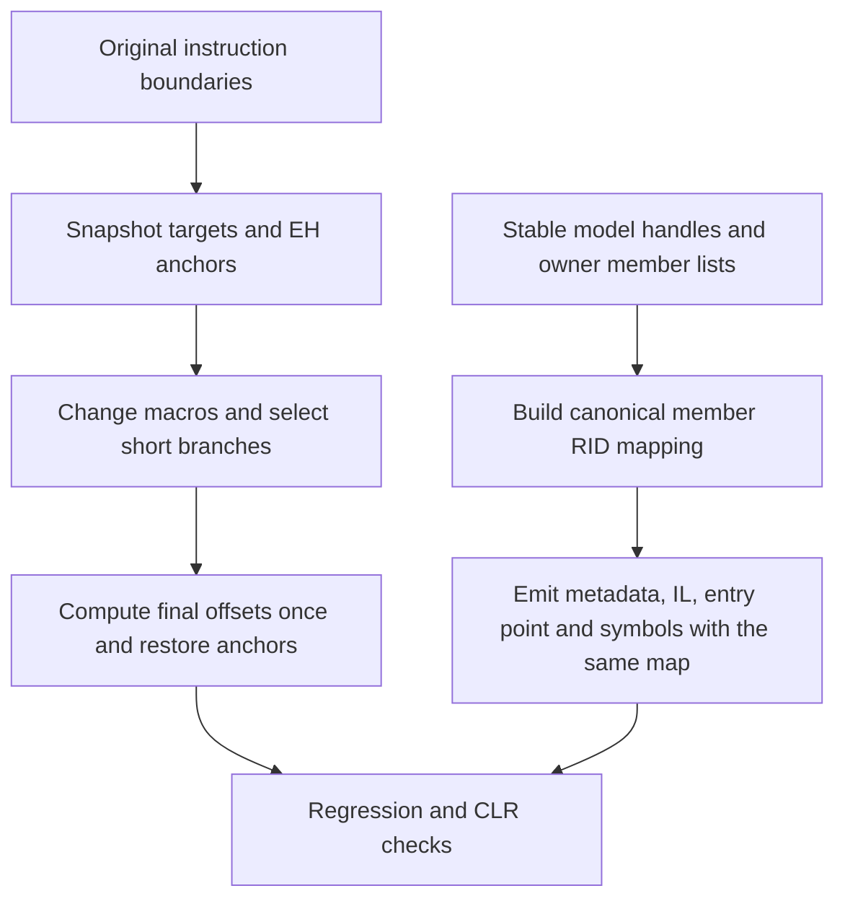

# Fix obfuscator library workarounds - Plan

## Scope & Non-Goals

- Repair the library defects identified by ObsidianObf's compatibility workarounds.
- Scope: cecil-rs IL editing and canonical managed metadata/IL/symbol emission, focused regressions and relevant existing checks.
- Preserve unrelated work, public handle identities, mixed-mode token preservation and deterministic output. Do not remove consumer workarounds or migrate ObsidianObf dependencies in this task.
- After verified completion, the user authorized a local commit on 2026-10-24. Pushes, unbounded fuzzing and unrelated runtime/obfuscation changes remain outside the task.

## Acceptance Criteria

- [x] Macro expansion/shortening preserves half-open try/handler regions, filter anchors and the code-end anchor, including changes to the last instruction.
- [x] Supported offset remapping keeps branches/switches on their intended instructions; ambiguous direct structural edits have a checked API instead of silently misrouting.
- [x] Appending/reordering managed methods/fields in existing types preserves ownership, entry point, IL references, member annotations and symbols after write/read.
- [x] Branch shortening avoids a full body traversal for each shrunken branch and works on large branch-heavy bodies.
- [x] Focused regressions, relevant existing fixture/mixed-mode/symbol checks, formatting and lint checks pass.

## Assumptions & Constraints

- The user explicitly names D:/cecil-rs as the repair target; it is the renamed successor to cecli-rs.
- Checkout starts clean at f30166a on main. Existing plans are completed and concern different work.
- Rust APIs use owned instructions with absolute offsets. Renumbering alone cannot infer identity after arbitrary destructive replacement; preserve the current API and document/check supported mappings.
- Necessary local compilation and regression checks are included in the user's repair request. Use cached offline locked dependencies and bounded tests.
- Main agent owns all changes; no delegated tasks.

## Baseline Tests

| Item | Command | Baseline result (at start) |
| --- | --- | --- |
| Checkout | git status --short; git log -6 --oneline | Clean main at f30166a |
| Plan scan | python -X utf8 C:/Users/hwyyds/.codex/skills/task-planning/scripts/plan.py list | All prior plans completed |
| Static inspection | edit.rs, write/token_map.rs, write/emit_metadata.rs | EH is shifted then remapped again; old end is computed after size changes; field/method tokens assume arena order; branch shrinking renumbers per branch |
| Targeted baseline | cargo test --offline --locked -p cecil-rs --lib edit::tests | Existing 17 tests passed; first build 25.20s |
| New reproductions | Same edit command with three added regressions | All three new tests fail: repeated EH migration, lost final-code anchor and long narrowing without EH updates |

## Diagram

## Task Checklist

| ID | Task | Owner | Deps | Done |
| --- | --- | --- | --- | --- |
| T1 | Inspect implementation and record baseline; reproduce precise failures | [main] | - | [x] |
| T2 | Repair checked IL relocation and EH anchors with regressions | [main] | T1 | [x] |
| T3 | Replace per-branch whole-body renumbering with bounded efficient layout updates | [main] | T2 | [x] |
| T4 | Repair managed member RID allocation and all dependent references with roundtrip regressions | [main] | T1 | [x] |
| T5 | Validate runtime compatibility, relevant existing tests, formatting and lints | [main] | T2,T3,T4 | [x] |
| T6 | Review final diff, record exact evidence and close plan | [main] | T5 | [x] |

## Sub-agent Registry

No delegated tasks.

| Task ID | Agent Ref | Status | Integration | Owned Files | Checkpoint / Next Action | Updated |
| --- | --- | --- | --- | --- | --- | --- |

## Risks & Rollback

| Risk | Likelihood / Impact | Mitigation | Rollback |
| --- | --- | --- | --- |
| Changed method RIDs affect IL, generics or symbols | Medium / high | Shared deterministic layout mapping and comprehensive member-reference regression | Revert only task edits |
| Macro layout edits change EH ownership | Medium / high | Snapshot original anchors before any size change; filter/finally/code-end tests | Revert only task edits |
| Mixed-mode native references require fixed tokens | Medium / high | Keep preserved-layout emission separate; run mixed-mode regressions | Revert only task edits |
| Branch optimization remains expensive in pathological inputs | Medium / medium | Use indexed size deltas and a large synthetic branch corpus | Revert only task edits |

## Blockers

None.

## Change Log

| Time | Task ID | File / Task | Change | By |
| --- | --- | --- | --- | --- |
| 2026-10-23 22:48 | T1 | Repository and plan | Reconciled clean checkout, existing completed plans, source naming and identified defect sites | main |
| 2026-10-23 22:56 | T1 | crates/cecil-rs/src/edit.rs | Added three deterministic failing EH regressions, including the consumer's exact finally/filter cases and related i8 narrowing | main |
| 2026-10-23 23:08 | T2,T3 | crates/cecil-rs/src/edit.rs | Added checked BodyLayout snapshots, preserved original EH/code-end anchors, avoided duplicate-offset retargeting and replaced per-branch renumbering with Fenwick size queries; corrected i8 replacement EH ownership | main |
| 2026-10-24 09:37 | T1,T4 | Repository reconciliation | Canonical definition_rows, metadata/IL/entry-point/symbol remapping and member_emission regressions are already on disk; restore the missed baseline checkbox and continue final member-reference coverage and verification alongside review-finding plan 20261024-092151-fix-review-findings | main |
| 2026-10-24 09:55 | T4 | crates/cecil-rs/tests/member_emission.rs | Added roundtrips for field data/layout/constants/marshal info, method/parameter/return annotations, properties/events/accessors, generic owners/constraints, overrides, MethodSpec and raw definition tokens; verify definition-parented CDI against emitted metadata and preserve caller handles | main |
| 2026-10-24 10:01 | T4,T5 | portable_writer.rs and target/review-probes | Integrated related review fix for Portable PDB counts/index widths and sorted scope/CDI references; independent .NET accepts all generated outputs and CLR executes appended helper/field references | main |
| 2026-10-24 10:08 | T5 | Workspace checks | Default tests 598 and all-feature tests 605 pass, including fixture/mixed-mode/symbol checks and the 50,000-branch regression; formatting, both clippy configurations and warning-denied rustdoc pass | main |
| 2026-10-24 10:08 | T6 | Documentation, final diff and plan | Reviewed canonical ownership/token mapping and IL relocation, reconciled every checklist item, documented stable handles/private deferred writes and recorded completion evidence; dependency versions unchanged | main |
| 2026-10-24 10:14 | T6 | Local commit authorization | User requested COMMIT after verified completion; reconciled the same 18 repair files and prepared a local commit including both completed plans | main |

## Verification Evidence

| Time | Command | Result | Notes (regression vs. pre-existing) |
| --- | --- | --- | --- |
| 2026-10-23 23:08 | cargo test --offline --locked -p cecil-rs --lib edit::tests | 25 passed in 0.08s | Includes all three previously failing EH cases, checked nonmutation and 50,000 branches with macro roundtrip |
| 2026-10-24 09:55 | cargo test --offline --locked --quiet -p cecil-rs --test member_emission | 4 passed | Appended/reordered ownership, IL/entry-point/annotation references, portable/native symbols and sidecar/embedded PDBs across Immediate/Lazy/Deferred modes |
| 2026-10-24 10:01 | pwsh -NoProfile -ExecutionPolicy Bypass -File target/review-probes/check_closeout.ps1 | Passed | .NET sidecar/embedded/wide PDBs and correct method/scope/CDI lookups; CLR AddedField=42 confirms remapped IL and ownership |
| 2026-10-24 10:08 | cargo test --workspace --all-features --offline --locked --quiet | 605 passed, 0 failed | Includes 50,000-branch layout/macro roundtrip, fixture/mixed-mode/symbol/member checks and doctests |
| 2026-10-24 10:08 | cargo test --workspace --offline --locked --quiet | 598 passed, 0 failed | Default feature configuration |
| 2026-10-24 10:08 | cargo clippy --workspace --all-targets --all-features --offline --locked -- -D warnings | Passed | All-feature lint |
| 2026-10-24 10:08 | cargo clippy --workspace --all-targets --offline --locked -- -D warnings | Passed | Default-feature lint |
| 2026-10-24 10:08 | cargo fmt --all; cargo fmt --all -- --check | Passed | Final source formatting |
| 2026-10-24 10:08 | RUSTDOCFLAGS=-D warnings cargo doc --workspace --all-features --offline --locked --no-deps | Passed | Final API docs are warning-clean |
| 2026-10-24 10:08 | git diff --check; git status --short; git diff --stat; parsed Cargo.lock comparison | Passed | Reviewed 14 tracked changed files and the new definition/member-regression/plan files; lock changes only normalize ordering |

## Bug & Fix Log

| Time | Symptom | Root cause | Fix (files) | Guard added (test/assert/check) |
| --- | --- | --- | --- | --- |
| 2026-10-23 23:08 | Finally endpoint moved twice; final widened leave lost code-end; narrowed i8 lost EH ownership | Post-edit offsets/size were mistaken for original anchors; i8 transform omitted EH updates | edit.rs uses pre-edit BodyLayout and one net replacement shift | Finally/filter/code-end/i8 regression tests now pass |
| 2026-10-23 23:08 | Large branch-heavy methods required quadratic work | Full renumber after each branch shrink | edit.rs Fenwick prefix sizes with final relocation once | 50,000-branch exact target/macro roundtrip test |

## Completion Summary

IL macro expansion/shortening now restores try/handler/filter/code-end anchors from the original layout, and checked BodyLayout relocation rejects unsupported ambiguous edits without mutating the body. Branch shrinking uses Fenwick prefix-size queries with one final relocation; the 50,000-branch regression passes.

Canonical managed member RIDs follow owner lists while source arena handles stay stable. Metadata, IL/raw tokens, entry points, annotations, parameters, properties/events/accessors, generic owners/constraints, MethodSpec, overrides and portable/native/MDB symbols use the same mapping. Related review-finding repairs complete deferred writes and Portable PDB external counts/index widths/sorted scope references.

Default workspace tests (598), all-feature tests (605), formatting, both clippy configurations and warning-denied rustdoc pass. Independent .NET readers accept the PDB outputs and CLR execution calls an appended helper and assigns the appended field to 42. All library-repair criteria are met, with no remaining repair work or deferred checks. Consumer-workaround removal/dependency migration stays outside this plan's scope. The user subsequently authorized a local commit of the completed repairs and plans; no push was requested.

## Next Steps

None. Library repair and verification are complete.
