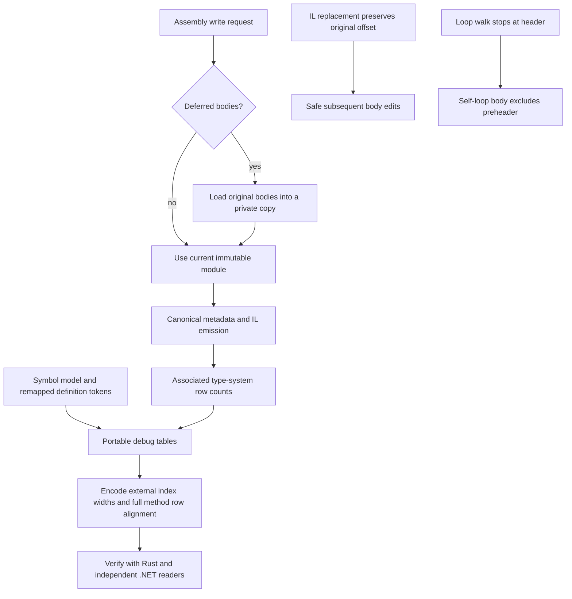

# Fix repository review findings - Plan

## Scope & Non-Goals

- Fix Portable PDB external-table bookkeeping and interoperability, deferred assembly writing, equal-size instruction replacement, standalone symbol mapping and self-loop analysis.
- Preserve the existing uncommitted member-emission and IL-relocation changes from related plan 20261023-224540-fix-obfuscator-library-workarounds. This new plan tracks the five findings requested in this conversation, not that plan's additional consumer work.
- Add focused regression tests and run the repository's local acceptance checks. After completion, the user authorized a local commit on 2026-10-24; pushes, deployment and external service work remain outside the task.

## Acceptance Criteria

- [x] Portable PDBs contain associated type-system table counts, correct index widths and a MethodDebugInformation row for every associated MethodDef; .NET System.Reflection.Metadata accepts generated sidecar and embedded output.
- [x] Writing a Lazy/Deferred assembly preserves unloaded IL bodies and metadata edits without mutating the caller's handles/model.
- [x] Equal-size instruction replacement preserves offsets and subsequent insertion/removal keeps intended branch targets.
- [x] Standalone sparse symbol models remain supported; complete managed models still validate and remap canonical definition RIDs.
- [x] Self-loop natural loops exclude their preheaders and unrelated entry blocks.
- [x] Relevant unit/integration tests, all-feature workspace tests, formatting and clippy pass.

## Assumptions & Constraints

- The user explicitly requested all five fixes after the review. Necessary local regression/build/lint checks are included; the previous complete local test pass took about nine seconds.
- Baseline has seven modified source files, an untracked definition_rows.rs, member_emission.rs and an existing active plan. Preserve these changes and their stable arena handles.
- Use cached offline dependencies. The review showed Cargo rewrites the existing lockfile's package ordering; preserve dependency versions and record any necessary normalization.
- Main agent owns all changes; no delegated tasks. New interfaces and shared writer/model changes are sequenced.

## Baseline Tests

| Item | Command | Baseline result (at start) |
| --- | --- | --- |
| Repository | git status --short; plan.py list | f30166a main with existing member/IL edits; one overlapping earlier active plan |
| Workspace | cargo test --workspace --all-features --offline | One failure: portable_attachment_preserves_each_points_document rejects an ownerless symbol model |
| Remaining baseline | cargo test --workspace --all-features --offline --quiet -- --skip portable_attachment_preserves_each_points_document | Remaining workspace tests pass |
| Reproductions | target/review-probes/review.exe | Lazy hello.exe loses both method bodies; equal-size replacement plus insert creates Branch(1); self-loop includes entry; PDB MethodDef count is zero |
| Independent PDB reader | pwsh -NoProfile -ExecutionPolicy Bypass -File target/review-probes/check_portable.ps1 | Original Portable fixture accepted; generated PDB rejected with Unknown tables |

## Diagram

## Task Checklist

| ID | Task | Owner | Deps | Done |
| --- | --- | --- | --- | --- |
| T1 | Reconcile baseline and record the five reproductions | [main] | - | [x] |
| T2 | Repair equal-size instruction offsets and natural self-loop collection with regressions | [main] | T1 | [x] |
| T3 | Preserve deferred IL during assembly writes with caller-model/metadata-edit regressions | [main] | T1 | [x] |
| T4 | Repair sparse standalone symbol mapping with validation/remapping regressions | [main] | T1 | [x] |
| T5 | Repair Portable PDB type-system counts, physical layout and facade integration with regressions | [main] | T3,T4 | [x] |
| T6 | Run focused/full tests, independent .NET compatibility checks, formatting and lint | [main] | T2,T3,T4,T5 | [x] |
| T7 | Review diff, record verification and close this plan | [main] | T6 | [x] |

## Sub-agent Registry

No delegated tasks.

| Task ID | Agent Ref | Status | Integration | Owned Files | Checkpoint / Next Action | Updated |
| --- | --- | --- | --- | --- | --- | --- |

## Risks & Rollback

| Risk | Likelihood / Impact | Mitigation | Rollback |
| --- | --- | --- | --- |
| External PDB row counts alter encoded widths | Medium / high | Boundary-width regression and .NET reader validation | Revert only this task's changes |
| Deferred-body loading overwrites edits or changes native snapshots | Medium / high | Preserve caller model, existing bodies and original RID identity; test metadata edits | Revert only this task's changes |
| Sparse symbol fallback masks malformed complete ownership | Medium / medium | Separate absence of ownership information from invalid nonempty owner lists | Revert only this task's changes |

## Blockers

None.

## Change Log

| Time | Task ID | File / Task | Change | By |
| --- | --- | --- | --- | --- |
| 2026-10-24 09:24 | T1 | Repository and plan | Reconciled existing changes and earlier plan; preserved exact review baseline and independent reproductions | main |
| 2026-10-24 09:32 | T2 | edit.rs, flow.rs | Replacement inherits the previous instruction offset; natural-loop walk stops at the header; regression tests cover subsequent insert/remove and entry/preheader self-loops | main |
| 2026-10-24 09:37 | T3,T4 | Repository reconciliation | Existing deferred-write and sparse-symbol implementations are on disk but were not logged; full local test run exposed an authored-body assertion using max_stack 0 although tiny IL headers imply 8; Portable PDB implementation remains incomplete | main |
| 2026-10-24 09:37 | T3 | assembly.rs | Preserve explicitly edited raw call-site signature blobs during deferred loading; use the correct tiny-header max_stack in the authored/appended-body regression | main |
| 2026-10-24 09:45 | T3 | assembly.rs, read/instructions.rs | Verified private, transactional deferred loading, preservation of metadata edits and authored/appended bodies, including an appended calli signature; loading failures retain model and lazy state | main |
| 2026-10-24 09:45 | T4 | write/definition_rows.rs | Sparse ownerless models retain source RIDs; nonempty ownership and complete identity mappings validate definitions; four focused regressions pass | main |
| 2026-10-24 09:45 | T5 | cecil-metadata/src/builder.rs, cecil-pdb/src/portable_writer.rs, assembly.rs | Encode external index widths from associated PE row counts, exclude physical Module and debug counts from #Pdb, align all MethodDebugInformation rows and pass emitted entry/local signature tokens through managed output; corrected the embedded fixture to contain its associated method | main |
| 2026-10-24 09:55 | T5 | crates/cecil-rs/tests/member_emission.rs | Added sidecar/embedded integration checks for all emitted type-system counts, remapped entry points, actual local signature RIDs, trailing empty methods, checksums and immutable Immediate/Lazy/Deferred caller models | main |
| 2026-10-24 10:01 | T5 | portable_writer.rs | Independent .NET lookup exposed unsorted scope/CDI rows after method remapping. Sort scopes by emitted method/range, move owned locals/constants and remap their debug parents, then sort CDI by parent; add a deterministic ownership/sorting regression | main |
| 2026-10-24 10:01 | T5,T6 | target/review-probes | Generate standalone, sidecar, embedded and wide-index probes; independent System.Reflection.Metadata validates method alignment, entry, points, scope/CDI lookups and wide indexes; CLR executes remapped helper/field references correctly | main |
| 2026-10-24 10:08 | T6 | Workspace checks | Default workspace tests: 598 passed; all features: 605 passed; both clippy configurations, formatting and warning-denied all-feature rustdoc pass | main |
| 2026-10-24 10:08 | T7 | README.md, resolver.rs, assembly.rs, writer module docs | Document private deferred-write loading, stable source handles/canonical member RIDs, external PDB counts and sorted source scope handles | main |
| 2026-10-24 10:08 | T7 | Final diff and task record | Reviewed all changes, retained the related IL/member repairs, verified Cargo.lock has only ordering changes with identical versions/checksums, recorded final acceptance evidence and completion summary | main |
| 2026-10-24 10:14 | T7 | Local commit authorization | User requested COMMIT after verified completion; reconciled the same 18 repair files and prepared a local commit including both completed plans | main |

## Verification Evidence

| Time | Command | Result | Notes (regression vs. pre-existing) |
| --- | --- | --- | --- |
| 2026-10-24 09:24 | Review baseline commands above | Five findings reproduced | One pre-existing failing unit test is explicitly in repair scope |
| 2026-10-24 09:32 | cargo test --offline --quiet -p cecil-rs --lib edit::tests | 26 passed | Includes equal-size replacement and later-edit regression |
| 2026-10-24 09:32 | cargo test --offline --quiet -p cecil-rs --lib flow::tests | 8 passed | Includes correct entry and preheader self-loop bodies |
| 2026-10-24 09:37 | cargo test --workspace --all-features --offline --locked --quiet | 322/323 facade unit tests passed; authored/appended-body regression failed | Previously failing sparse-symbol attachment now passes; remaining packages stopped at the assertion failure |
| 2026-10-24 09:45 | cargo test --offline --locked --quiet -p cecil-rs --lib assembly::tests | 30 passed | Deferred-write, caller-model, failure atomicity, sparse attachment and existing portable/native/MDB facade tests pass |
| 2026-10-24 09:45 | cargo test --offline --locked --quiet -p cecil-rs --lib write::definition_rows::tests | 4 passed | Sparse, partial/duplicate, reordered and identity ownership cases |
| 2026-10-24 09:45 | cargo test --offline --locked --quiet -p cecil-pdb --lib portable_writer::tests | 12 passed | Includes 65,536 external methods, wide coded parents, trailing empty methods and invalid associated counts |
| 2026-10-24 09:55 | cargo test --offline --locked --quiet -p cecil-rs --test member_emission | 4 passed | Includes six emitted sidecar/embedded combinations, metadata row counts, entry/local-signature alignment and definition-parented CDI |
| 2026-10-24 10:01 | cargo test --offline --locked --quiet -p cecil-pdb --lib sorted_scopes_keep_locals_constants_and_debug_parents | Failed before fix: scope starts [3,0] instead of [0,3] | New regression matches independent .NET scope-lookup failure |
| 2026-10-24 10:01 | cargo test --offline --locked --quiet -p cecil-pdb --lib portable_writer::tests | 13 passed | Includes sorted scope ownership and remapped local/constant CDI parents |
| 2026-10-24 10:01 | cargo run --manifest-path target/review-probes/Cargo.toml --offline --locked --quiet --target-dir target --bin closeout | Passed | Rebuilds probe images/PDBs and confirms Lazy/Deferred body retention |
| 2026-10-24 10:01 | pwsh -NoProfile -ExecutionPolicy Bypass -File target/review-probes/check_closeout.ps1 | Passed | Standalone, sidecar, embedded, MethodDef 65536/Field 2048, method/scope/CDI lookup and CLR AddedField=42 |
| 2026-10-24 10:08 | cargo test --workspace --all-features --offline --locked --quiet | 605 passed, 0 failed | Includes mixed-mode, symbols, member emission, malformed-input regressions and five doctests |
| 2026-10-24 10:08 | cargo test --workspace --offline --locked --quiet | 598 passed, 0 failed | Default feature configuration and doctests |
| 2026-10-24 10:08 | cargo clippy --workspace --all-targets --all-features --offline --locked -- -D warnings | Passed | All-feature library, examples, tests and benchmarks are warning-clean |
| 2026-10-24 10:08 | cargo clippy --workspace --all-targets --offline --locked -- -D warnings | Passed | Default-feature cfg paths are warning-clean |
| 2026-10-24 10:08 | cargo fmt --all; cargo fmt --all -- --check | Passed | Final source tree formatted and verified |
| 2026-10-24 10:08 | RUSTDOCFLAGS=-D warnings cargo doc --workspace --all-features --offline --locked --no-deps | Passed | Includes final API/documentation corrections |
| 2026-10-24 10:08 | git diff --check; git status --short; git diff --stat | Passed | 14 tracked files: +1250/-289; new definition_rows.rs, member_emission.rs and two plan files reviewed separately; generated probes remain under ignored target/ |
| 2026-10-24 10:08 | Parsed Cargo.lock comparison against HEAD using Python tomllib | Passed | Only package/dependency ordering changed; versions, sources and checksums are unchanged |

## Bug & Fix Log

| Time | Symptom | Root cause | Fix (files) | Guard added (test/assert/check) |
| --- | --- | --- | --- | --- |
| 2026-10-24 09:32 | Equal-size replacement reset an instruction offset; self-loop included outside predecessors | Replacement skipped relayout and kept the new offset; loop walk expanded the header | edit.rs assigns the original offset; flow.rs stops at the header | Targeted replacement/insertion/removal and self-loop tests |
| 2026-10-24 09:45 | Deferred writes omitted original bodies or overwrote authored call-site data | Writer serialized the deferred model; body loading replaced raw signature state | assembly.rs writes a privately loaded clone and merges explicit call-site signatures | Lazy/Deferred metadata edits, appended calli, determinism and failed-load state regressions |
| 2026-10-24 09:45 | Standalone symbols failed ownership checks; identity mappings skipped token validation | Symbol mapping assumed complete managed ownership or discarded identity maps | definition_rows.rs separates sparse models and retains validated complete maps | Four ownership/token regressions |
| 2026-10-24 09:45 | .NET rejected emitted Portable PDBs and large external RIDs used narrow indexes | Physical Module row and debug-table #Pdb counts violated the format; width computation ignored external counts | portable_writer.rs separates external/physical tables and metadata builder uses associated counts for widths | Trailing method, 65,536-method/simple-index and 2,048-field/coded-index regressions; .NET check pending |
| 2026-10-24 10:01 | .NET could not find scopes for reordered AddedHelper | Sorted tables retained old insertion order after method-RID remapping | portable_writer.rs sorts scope/CDI rows and relocates owned locals/constants and their CDI parents | Focused before/after regression and independent .NET lookups now pass |

## Completion Summary

All five reviewed defects are repaired. Deferred assembly writes preserve unloaded bodies, explicit metadata/call-site edits and the caller's model. Equal-size replacement and self-loop analysis have targeted guards. Sparse standalone symbol models retain their RIDs while complete managed ownership and definition tokens are validated.

Portable PDB output now uses emitted type-system counts and local signature/entry tokens, keeps only debug tables in the physical metadata stream, includes empty rows for every associated method and sorts scope/CDI rows while relocating owned locals/constants and their parents. Independent System.Reflection.Metadata accepts standalone, sidecar, embedded and wide-index output; CLR execution confirms remapped helper/field references.

Default workspace tests (598), all-feature tests (605), both clippy configurations, formatting and warning-denied rustdoc pass. All repair-scope acceptance criteria are met; no checks or implementation remain deferred. The related IL/member repair is preserved and its plan is closed alongside this one. The user subsequently authorized a local commit of the completed repairs and plans; no push or external service work was requested.

## Next Steps

None. Repair and verification are complete.
