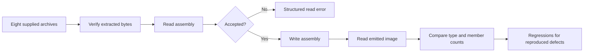

# Fix October 31 fuzz roundtrip cases - Plan

## Scope & Non-Goals

- Goal: repair every reproduced roundtrip invariant failure in the eight supplied archives.
- In scope: responsible reader/writer primitives, deterministic regression tests, and replay of artifacts and corpus.
- Non-goals: unrelated refactoring, changing fuzz assertions, and unbounded mutation campaigns.
- Follow-up: the user authorized committing and pushing the verified repair to origin/main.

## Acceptance Criteria

- [x] All eight crash artifacts satisfy the unchanged read/write/read fuzz invariant.
- [x] All 3,547 supplied inputs replay without panics or invariant failures; malformed inputs may return structured read errors.
- [x] Synthetic regressions cover each root cause and nearby valid cases.
- [x] Relevant tests, formatting, lint and LOC checks pass with no new regressions.

## Assumptions & Constraints

- Follow existing crate layering, Recover/Strict input policies, Rust 1.88 compatibility, and coding-standards.
- Preserve supplied ZIP archives and existing ignored scratch data.
- Initial tracked source checkout is clean; only the supplied new folder is untracked.
- Later diff review found concurrent edits outside this task: Cargo.toml release settings changed to no debug information, panic abort and fat LTO; benchmark artifacts were deleted. Preserve these unrelated workspace changes. The tested dev profile and independent fuzz workspace do not use that release profile.
- All prior plans are completed. Existing ignored October 31 extraction/replay files are available; verify them against archives and rebuild against current sources before relying on them.
- Work is sequential because diagnosis, regression design and implementation share reader/writer contracts. No delegation.
- Run local checks necessary to repair and validate these fuzz cases; use bounded replay rather than open-ended fuzzing.

## Baseline Tests

| Item | Command | Baseline result (at start) |
| --- | --- | --- |
| Commit / ref | git status --short; git rev-parse --short HEAD | Clean tracked main at 05a62bf |
| Archive inventory | ZIP central-directory inspection | Eight ZIPs; 3,547 files including eight crashes |
| Existing replay log | tmp/fuzz-roundtrip-20261031/baseline-artifacts.log | Historical local evidence: seven definition-token writer errors, one successful artifact; needs fresh confirmation |
| Fresh artifact replay | target/debug/oct31-roundtrip-replay.exe -v archive-*/artifacts | Seven identical definition-token writer errors; one successful artifact |
| Fresh corpus replay | target/debug/oct31-roundtrip-replay.exe archive-* | 3,547 inputs: 2,610 successful roundtrips, 925 read rejections, 12 definition-token errors |

## Diagram

## Task Checklist

| ID | Task | Owner | Deps | Done |
| --- | --- | --- | --- | --- |
| T1 | Inspect instructions, checkout and archive inventory | [main] | - | [x] |
| T2 | Verify existing extraction, rebuild replay, reproduce artifacts and corpus | [main] | T1 | [x] |
| T3 | Add deterministic regressions and repair responsible primitives | [main] | T2 | [x] |
| T4 | Replay full corpus and run required compatibility/lint checks | [main] | T3 | [x] |
| T5 | Review diff, record evidence and close plan | [main] | T4 | [x] |

## Sub-agent Registry

No delegated tasks.

| Task ID | Agent Ref | Status | Integration | Owned Files | Checkpoint / Next Action | Updated |
| --- | --- | --- | --- | --- | --- | --- |

## Risks & Rollback

| Risk | Likelihood / Impact | Mitigation | Rollback |
| --- | --- | --- | --- |
| Rejecting valid metadata or breaking edited-model token remapping | Medium / high | Cover valid references, Strict/Recover and existing emission regressions | Revert only this task's source changes |
| Hidden corpus variants | Medium / medium | Replay every supplied input and classify all failures | Extend fixes to reproduced roots |
| Stale local replay executable | Medium / medium | Verify archive bytes and freshly rebuild against current checkout | Rebuild again after source changes |

## Blockers

None.

## Change Log

| Time (YYYY-MM-DD HH:mm) | Task ID | File / Task | Change | By |
| --- | --- | --- | --- | --- |
| 2026-10-31 20:35 | T1 | Inventory and plan | Read coding/task-planning skills and project docs; all old plans completed; identified eight archives and existing ignored replay preparation | main |
| 2026-10-31 20:38 | T2 | Archive verification and fresh replay | Verified all 3,547 extracted files byte-for-byte against the eight ZIPs; rebuilt replay against current sources. Seven artifacts plus five corpus entries fail because raw IL tokens are rejected by strict definition mapping | main |
| 2026-10-31 20:38 | T3 | tests/raw_il_tokens.rs | Added synthetic raw-token roundtrip matrix across operand kinds, nil/unknown/out-of-range tokens, Strict/Recover and Immediate/Lazy/Deferred; cover valid raw token reordering and retained typed-handle validation | main |
| 2026-10-31 20:40 | T3 | Pre-fix regression run | New hostile-token test fails at ldfld Field RID 3 with the same writer error; valid raw reordering and typed-handle validation tests already pass | main |
| 2026-10-31 20:40 | T3 | write/emit_il.rs | Preserve raw IL tokens when definition mapping has no source row; existing definitions still remap, and typed operands/public definition-token validation retain their errors. Updated emission docs | main |
| 2026-10-31 20:47 | T3 | Post-fix tests and LOC assessment | Three new regressions and four existing member-emission tests pass. emit_il.rs is 821 lines and remains cohesive body serialization plus its unit tests; no mechanical split needed. New integration test file is 178 lines | main |
| 2026-10-31 20:47 | T4 | Corpus and workspace verification | Rebuilt replay: all 3,547 inputs pass the invariant, with 2,622 successful roundtrips and 925 read rejections. All 608 workspace/all-feature tests pass; default-feature Clippy and formatting pass | main |
| 2026-10-31 20:47 | T4 | Linux ASan replay | WSL sandbox access required escalation. Approved Linux offline nightly build succeeds; unchanged roundtrip target executes eight artifacts and all five failing corpus entries successfully with ASan | main |
| 2026-10-31 20:49 | T4 | Final lint | Strongname feature Clippy pass succeeds with warnings denied; both CI lint feature sets are clean | main |
| 2026-10-31 20:49 | T5 | Final review and closeout | Reviewed the single production behavior change, updated docs and three standalone regressions. Recorded all evidence; unrelated Cargo/benchmark changes and supplied ZIPs remain intact | main |
| 2026-10-31 21:02 | T5 | Authorized commit and push preparation | User requested commit+push and confirmed continuation. Rechecked the source, three regressions and evidence; fetched origin/main and confirmed it matches 05a62bf. A transient Schannel TLS failure was resolved using a command-local OpenSSL backend with certificate verification retained. Package only the repair source, regression tests and this record | main |

## Verification Evidence

| Time | Command | Result | Notes (regression vs. pre-existing) |
| --- | --- | --- | --- |
| 2026-10-31 20:35 | ZIP inventory; git status --short | Eight artifacts and clean tracked checkout | No source changes yet |
| 2026-10-31 20:38 | Python ZIP byte comparison | All 3,547 files match, crash SHA1s match artifact names | Reused extraction is confirmed current |
| 2026-10-31 20:38 | cargo build --offline --locked --manifest-path tmp/fuzz-roundtrip-20261031/tool/Cargo.toml --target-dir target | Passed | Fresh unoptimized replay executable, overflow/debug checks enabled |
| 2026-10-31 20:38 | target/debug/oct31-roundtrip-replay.exe archive-* | 12 failures, all definition-token write errors | fresh-baseline-corpus.log; includes seven artifacts and five corpus entries |
| 2026-10-31 20:40 | cargo test --offline --locked -p cecil-rs --test raw_il_tokens -- --nocapture | Expected pre-fix failure: one fails, two pass | raw-token-pre-fix.log; synthetic regression reaches the same bug without ZIP dependencies |
| 2026-10-31 20:47 | cargo test --offline --locked -p cecil-rs --test raw_il_tokens --test member_emission -- --nocapture | Seven passed, zero failed | raw-token-post-fix.log; includes reference ordering, symbols and typed-handle validation |
| 2026-10-31 20:47 | target/debug/oct31-roundtrip-replay.exe archive-* | 3,547 inputs; 2,622 roundtrips, 925 rejections, zero failures | fixed-corpus.log; same input bytes and fuzz invariant as baseline |
| 2026-10-31 20:47 | cargo test --offline --locked --workspace --all-features | 608 passed, zero failed or ignored | workspace-tests.log; 27 test-result records, including doctests |
| 2026-10-31 20:47 | cargo clippy --offline --locked --workspace --all-targets -- -D warnings | Passed | clippy-default.log; CI default feature set |
| 2026-10-31 20:49 | cargo clippy --offline --locked --workspace --all-targets --features cecil-rs/strongname -- -D warnings | Passed | clippy-strongname.log; CI signing feature set |
| 2026-10-31 20:47 | cargo fmt --all --check; git diff --check | Passed | Existing Git line-ending notices are informational |
| 2026-10-31 20:47 | python -X utf8 C:/Users/hwyyds/.codex/skills/coding-standards/scripts/check_loc.py --check crates/cecil-rs/src/write/emit_il.rs crates/cecil-rs/tests/raw_il_tokens.rs | Passed; 821 and 178 lines | Source file exceeds the soft threshold only; cohesive body emitter and tests retained |
| 2026-10-31 20:47 | wsl -d archlinux --exec env PATH=/root/.cargo/bin:/usr/sbin:/usr/bin:/sbin:/bin CARGO_NET_OFFLINE=true cargo +nightly fuzz build roundtrip --codegen-units 16 | Passed in 23.30s | Fresh Linux nightly ASan build, optimized with debug information |
| 2026-10-31 20:47 | wsl -d archlinux --exec /mnt/d/cecil-rs/fuzz/target/x86_64-unknown-linux-gnu/release/roundtrip -rss_limit_mb=2560 -timeout=25 [eight crash paths and five failed corpus paths] | All 13 fixed inputs execute successfully, exit 0 | asan-artifacts.log; actual unchanged fuzz target; no mutation campaign |

## Bug & Fix Log

| Time | Symptom | Root cause | Fix (files) | Guard added (test/assert/check) |
| --- | --- | --- | --- | --- |
| 2026-10-31 20:47 | Seven crash artifacts and five corpus entries read successfully but writing fails with an out-of-source-model definition token | Reader intentionally retains unresolved tokens as ROperand::Token; managed IL emission mistakenly applies mandatory definition-row validation to those opaque operands | write/emit_il.rs remaps known definitions and preserves tokens without a source-row mapping; typed/public definition validation is unchanged | tests/raw_il_tokens.rs covers nil/unknown/out-of-range tokens across four operand kinds, two input policies and three reading modes, valid raw-reference reorder and invalid typed handles; full corpus plus ASan replay |

## Completion Summary

Fixed all 12 reproduced failures (seven crash artifacts and five corpus entries) by preserving unresolved raw IL tokens at the serialization boundary. Existing definition tokens still follow emitted member order; typed handles and explicit definition-token queries still reject invalid references. The eighth crash artifact already passed on the initial checkout and remains covered by replay.

All 3,547 supplied inputs now satisfy the unchanged fuzz property: 2,622 successful roundtrips and 925 structured read rejections, with zero failures. Three synthetic regressions pass across token forms, operand kinds, read policies and reading modes. All 608 workspace/all-feature tests, both CI Clippy feature sets, formatting, whitespace and LOC checks pass. A fresh Linux nightly ASan build executes all eight artifacts and five previously failing corpus entries successfully; this is fixed-input replay, not a mutation campaign.

Task-owned changes are limited to write/emit_il.rs, tests/raw_il_tokens.rs and this plan. Existing scratch data was verified before reuse; logs remain under ignored tmp/fuzz-roundtrip-20261031. Concurrent Cargo.toml release-profile changes and benchmark deletions were preserved. The user subsequently authorized committing and pushing the three validated repair files to origin/main. No remaining repair work or deferred acceptance checks.

## Next Steps

None; repair, regression coverage and verification are complete.
